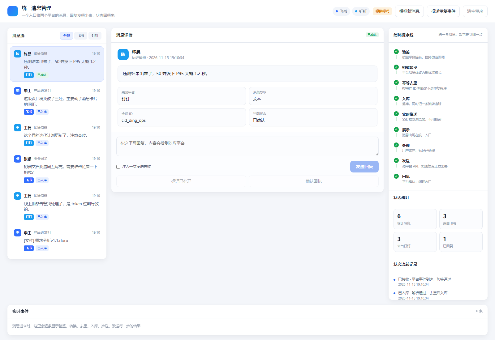

# UnifiedMessagesManagement

飞书、钉钉的消息和待办分散在两个客户端，来回切换容易漏事。这个项目把它们收进一个网页：新消息实时进来，读完可以直接回复，回复真正发到平台上，发送结果和状态再同步回页面。

参赛项目，对应智能应用创新开发大赛赛题 A「多平台连接器与统一消息管理」。



## 现在能跑通什么

代码已经在仓库里，`python app.py` 就能启动，模拟模式不依赖任何平台账号，完整闭环可以现场演示：

| 环节 | 模拟模式 | 真实平台 |
|---|---|---|
| 接收两个平台的消息 | 可演示（内置事件源） | 钉钉已打通真人入站（Stream 长连接）；飞书仍缺公网回调 |
| 网页展示与实时推送 | 可用（SSE） | 同左 |
| 从网页回复到平台 | 可演示（返回模拟消息 ID） | 飞书走群 Webhook、钉钉走机器人单聊，实测都能真发到群里或手机上 |
| 状态回流与确认 | 可用 | 回执需接平台订阅 |
| 幂等去重、发送重试、死信 | 可用，界面上有按钮可直接触发 | 同左 |

飞书这一侧做了个折中：自建应用被租户策略挡住（返回 21001，排查过程写在接入指南里），发送方向改走群机器人 Webhook。在 `.env` 填上 `FEISHU_WEBHOOK_URL` 再重启服务，页面上点「发送回复」就是真的发进飞书群，这一步在本机验证过。

钉钉这边情况不一样：网页版已经停服，只能在桌面客户端里配；个人账号建不了群（点「确定」会跳单聊，群不生成），所以群机器人加在系统自带的「欢迎试用钉钉群」里，安全设置用「加签」。

真正的难点在接收方向。钉钉给了一条不用公网的绕法：Stream 模式，程序主动去连钉钉网关，消息从这条已经建好的 WebSocket 上推下来。这条路已经打通——手机钉钉的单聊里发一句，服务端 `/healthz` 的 `received_count` 从 0 变 1，网页列表顶上立刻出现那条消息，会话名显示「姚锋」；在网页上点回复，走机器人单聊接口发回手机，`processQueryKey` 返回、三个人员列表为空。

走通之前卡了几处，都不是权限问题，是几个必须单独点一次的按钮（应用要发布上线、机器人配置要单独发布、群里的普通消息不触发回调），清单在 [docs/钉钉接入指南.md](docs/钉钉接入指南.md) 第 10 节。

两边的群截图、接口返回和复现方式收在 [docs/验证记录.md](docs/验证记录.md)。

## 跑起来

```bash
pip install -r requirements.txt
python app.py
```

浏览器打开 http://127.0.0.1:8000 ，用 `demo` / `demo1234` 登录。

想跳过登录直接看界面，访问 http://127.0.0.1:8000/demo —— 这个入口只在模拟模式下开放，切到真实平台会自动关闭。

用 Docker 跑：

```bash
docker compose up --build
```

镜像自带健康检查（`/healthz`），数据目录挂载到宿主机 `./data`，容器重建不丢演示数据。

## 测试

40 个用例，只用标准库 `unittest`，不额外装依赖：

```bash
python -m unittest discover -s tests -v
```

覆盖三块：状态机的合法与非法流转、两个适配器的验签（含篡改签名和过期时间戳）、存储层的幂等去重与乐观锁。存储测试跑在临时数据库上，不动 `data/umm.db`。

## 页面怎么用

打开后是三栏：

- **左：消息流**。飞书蓝色、钉钉蓝色区分，每条带状态标签（已入库 / 已展示 / 已回复 / 已确认）。
- **中：消息详情与回复**。点一条消息看原文，底部写回复；勾上「注入一次发送失败」能看到重试链路，每次尝试都会记进下方的流转记录，刷新也不丢。
- **右：闭环流水线**。一条消息从验签、转换、去重、入库、推送、展示、处理、发送到回执，九步逐格点亮。卡在哪一步，一眼就看出来。

顶部三个按钮是演示用的：模拟新消息、投递重复事件（验证幂等）、清空重来。

## 一条消息的完整路径

```
平台事件
  → 验签 → 格式转换 → 幂等去重 → 入库(state=stored) → SSE 推送
  → 前端展示(state=displayed) → 用户处理(state=processed)
  → 提交回复(state=replying) → 调平台 API
  → 成功: state=replied → 回执确认 → state=confirmed
  → 失败: 指数退避重试 5 次 → 仍失败转 dead，人工补发
```

状态只能按这张表走，跳过任何一步都会被状态机拒绝：

| 当前状态 | 允许下一步 |
|---|---|
| received | stored / parse_failed / ignored |
| parse_failed | stored / dead |
| stored | displayed |
| displayed | processed |
| processed | replying |
| replying | replied / send_failed |
| send_failed | replying / dead |
| replied | confirmed |

## 目录结构

```
app.py                 入口：路由、登录、SSE、平台回调
config.py              所有可变配置集中在这里
core/
  schema.py            内部标准消息格式与校验
  state_machine.py     状态机定义与合法性校验
  store.py             SQLite 持久化、幂等去重、流转追踪
  bus.py               SSE 事件总线
  service.py           业务编排：接收、回复、重试、回执
adapters/
  base.py              适配器抽象接口
  feishu.py            飞书（群机器人 Webhook / mock / 真实 API）
  dingtalk.py          钉钉（群机器人 Webhook / 机器人单聊 / mock / 真实 API）
  dingtalk_stream.py   钉钉长连接（Stream 模式）入站通道
  mock_feed.py         演示用事件源
tests/
  test_state_machine.py  状态机：哪些跳转会放行，哪些会被挡
  test_adapters.py       验签与加签 URL 生成
  test_store.py          幂等去重、乐观锁、流转记录
  test_dingtalk_stream.py 长连接通道：前置检查、字段映射、幂等、状态快照
web/
  templates/index.html 页面结构
  static/style.css     样式
  static/app.js        前端逻辑
docs/
  需求分析文档.md       需求基线
  architecture.md      架构与关键设计
  index.md             项目路线图
  飞书接入指南.md       飞书真实发送：步骤、验证、排查
  钉钉接入指南.md       钉钉真实发送：步骤、验证、排查
  智能应用创新开发大赛_比赛设计文档.md  赛题原文
```

## 接口一览

| 方法 | 路径 | 用途 |
|---|---|---|
| GET | `/healthz` | 健康检查，部署探活用 |
| POST | `/api/login` | 登录，会话 30 分钟空闲失效 |
| GET | `/api/messages` | 消息列表，可按平台、状态过滤 |
| GET | `/api/messages/{id}` | 单条详情 + 全部状态流转记录 |
| POST | `/api/messages/{id}/display` | 标记已展示 |
| POST | `/api/messages/{id}/process` | 标记已处理 |
| POST | `/api/messages/{id}/reply` | 回复并发送到平台 |
| POST | `/api/messages/{id}/confirm` | 确认回执 |
| GET | `/api/stream` | SSE 实时事件 |
| POST | `/webhook/{platform}` | 平台回调入口 |
| POST | `/api/mock/push` | 造一条模拟事件 |
| POST | `/api/mock/duplicate` | 投递重复事件，验证去重 |

## 切到真实平台

设置环境变量后重启即可：

```bash
set UMM_MODE=real
set FEISHU_APP_ID=cli_xxx
set FEISHU_APP_SECRET=xxx
set DINGTALK_APP_KEY=xxx
set DINGTALK_APP_SECRET=xxx
```

或者更省事：把 `.env.example` 复制成 `.env`，直接在里面填（`config.py` 启动时会读，已存在的环境变量优先）。`.env` 已经在 `.gitignore` 里，不会被提交。

飞书开放平台的事件订阅地址填 `http://你的域名/webhook/feishu`，钉钉同理。本地调试可以用内网穿透把端口暴露出去。

### 只接发送方向（`UMM_MODE` 保持 mock）

不想动 `UMM_MODE`，只填 Webhook 也能让「发送回复」真发进对应平台的群：

```bash
set FEISHU_WEBHOOK_URL=https://open.feishu.cn/open-apis/bot/v2/hook/xxx
set DINGTALK_WEBHOOK_URL=https://oapi.dingtalk.com/robot/send?access_token=xxx
set DINGTALK_WEBHOOK_SECRET=sec_xxx
```

群机器人 Webhook 不需要 App ID / AppKey，也不受自建应用权限限制。飞书的自定义机器人不配安全设置也能发；钉钉的必须至少配一项（自定义关键词、加签、IP 段），选了「加签」就把 `SEC` 开头的串填到 `DINGTALK_WEBHOOK_SECRET`，代码会自动算签名。钉钉个人账号建不了群，演示用的群是系统自带的「欢迎试用钉钉群」。接收仍然是模拟的，适合初赛先把「真实推送」这件事演示出来。加机器人的步骤分两篇：[docs/飞书接入指南.md](docs/飞书接入指南.md)、[docs/钉钉接入指南.md](docs/钉钉接入指南.md)。

## 已知限制

写在前面，省得评委问到答不上来：

- 数据存 SQLite，单机。多实例部署要换 MySQL + Redis，`store.py` 是唯一需要改的文件。
- 没有实现负载均衡和容灾，加分项里的「高可用」目前只能讲到设计层面。
- AI 消息摘要没做。企业微信第三个平台没接。
- 登录是单账号配置在 `config.py`，没做用户表和多角色。
- 真实平台的签名校验：飞书做 token 比对，钉钉做 HMAC-SHA256 加时间戳偏差检查。代码层面都实现了，但本机没有公网 https 地址，HTTP 回调没跟真平台联调过——钉钉走的是 Stream 长连接，不经过这套 HTTP 验签。
- 钉钉接收走的是长连接 Stream，已连真网关、已收到真人消息。HTTP 回调那条路（`/webhook/dingtalk`）代码在，但需要公网地址，没联调。飞书只有 HTTP 回调一种，所以飞书接收仍然是断的。
- 钉钉发消息有两条通道：群自定义机器人 Webhook（只能发文本）和机器人单聊（企业内部应用）。网页上回复时优先走单聊，失败才退回群 Webhook。
- Dockerfile 和 compose 文件写好了，但**还没在干净 Linux 环境实际构建验证过**，决赛前必须补这一步演练。

## 比赛节点

| 节点 | 日期 | 要交的东西 |
|---|---|---|
| 初赛 | 11/20 | 设计文档、可行性分析、平台收发验证截图、源码初版 |
| 决赛 | 12/20 | 完整作品、5–8 分钟闭环演示视频、现场答辩 |

## 文档

| 文件 | 内容 |
|---|---|
| [docs/需求分析文档.md](docs/需求分析文档.md) | 需求基线：用户旅程、功能需求 MoSCoW 分级、非功能需求、追溯矩阵 |
| [docs/architecture.md](docs/architecture.md) | 架构与关键设计：为什么这么分层、幂等怎么做、状态机怎么保证不出错 |
| [docs/飞书接入指南.md](docs/飞书接入指南.md) | 从建应用到跑通第一个真实闭环，含排查表和已知限制 |
| [docs/钉钉接入指南.md](docs/钉钉接入指南.md) | 从装客户端到跑通第一个真实闭环，含个人账号建不了群的绕法 |
| [docs/index.md](docs/index.md) | 项目路线图、阶段划分、里程碑与风险预案 |
| [docs/验证记录.md](docs/验证记录.md) | 平台收发验证证据：群截图、接口原文、复现步骤 |
| [docs/智能应用创新开发大赛_比赛设计文档.md](docs/智能应用创新开发大赛_比赛设计文档.md) | 赛题原文与评分标准 |
