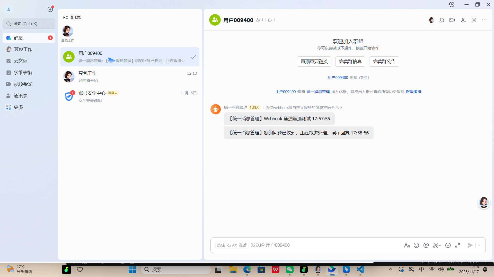
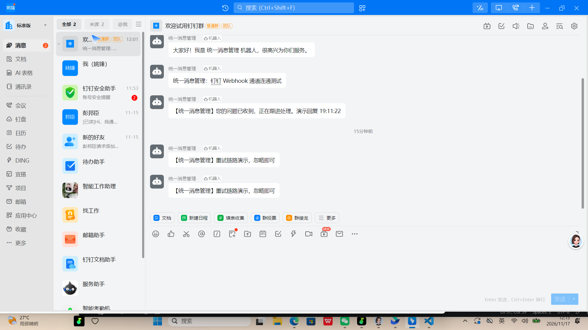
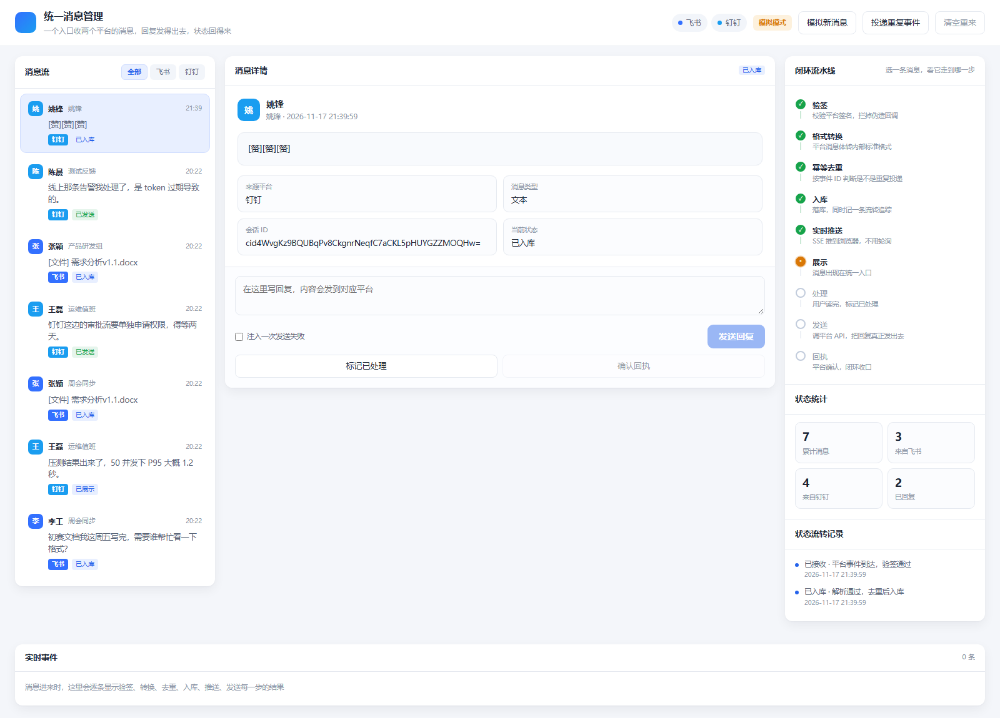
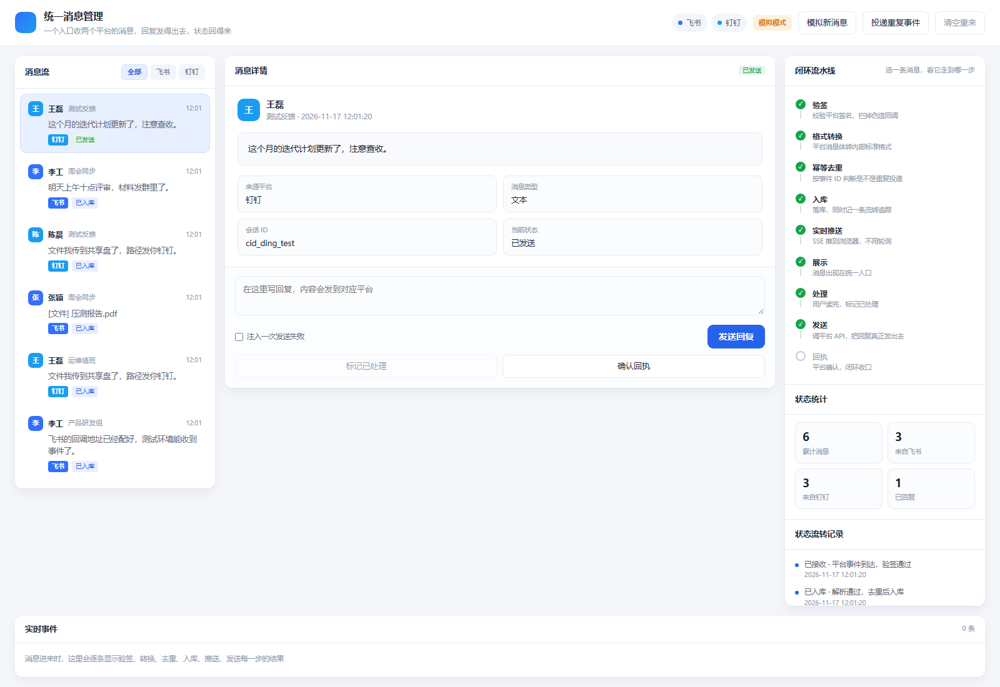

# 平台收发验证记录

这份文档只回答一个问题：**消息真的到平台了吗**。

每条结论都配三样东西：截图、接口返回、复现方式。截图存在 `docs/assets/verify/`，接口返回是从本机服务上直接取的原文。写进来的都是实际跑过的，没跑过的部分单独列在最后一节。

## 1. 验证环境

| 项 | 值 |
|---|---|
| 时间 | 2026-11-15 至 2026-11-17 |
| 机器 | 本机 Windows，Python 3.14 |
| 服务 | `http://127.0.0.1:8000`，`UMM_MODE=mock` |
| 飞书 | 桌面客户端 8.6.13，群「用户009400」，自定义机器人「统一消息管理」 |
| 钉钉 | 桌面客户端 7.1.0、手机客户端；群「欢迎试用钉钉群（团队）」挂自定义机器人；企业内部应用「统一消息管理」已上线，走 Stream 长连接 |

`UMM_MODE` 保持 `mock` 是故意的：接收方向走内置事件源，发送方向会优先走已经配好的群机器人 Webhook。这样演示时接收可以稳定跑，发送是真实推送。

## 2. 飞书：网页上的回复，真的进了群

| 步骤 | 结果 |
|---|---|
| 直调适配器发一条测试消息 | 群里出现「【统一消息管理】Webhook 通道连通测试 17:57:55」 |
| 通过项目接口把一条消息从入库推到回复 | 群里出现「【统一消息管理】您的问题已收到，正在跟进处理。演示回复 17:58:56」 |



截图里能看到机器人身份标注「通过 webhook 将自定义服务的消息推送至飞书」，说明消息是从 Webhook 通道进来的，不是手工发出的。

飞书这个通道不返回消息 ID，接口回的是 `{"code":0,"msg":"success"}`，所以判据是**群内是否出现对应文本**，不是返回值里的 ID。

## 3. 钉钉：同样的闭环，另外多验了重试

| 步骤 | 结果 |
|---|---|
| 直调适配器发一条测试消息 | 群里出现「统一消息管理：钉钉 Webhook 通道连通测试」 |
| 通过项目接口推一条消息到回复 | 群里出现「【统一消息管理】您的问题已收到，正在跟进处理。演示回复 19:11:22」 |
| 勾选「注入一次发送失败」后回复 | 前两次模拟失败，第三次成功，群里收到「【统一消息管理】重试链路演示，忽略即可」 |



截图中间隔着 15 分钟的两条「重试链路演示」，是 11/17 两次独立跑出来的，一次是改代码前的回归，一次是改完后的回归。

这条消息在系统里的完整流转记录，取自 `/api/messages/{id}`：

```
received    | 平台事件到达，验签通过
stored      | 解析通过，去重后入库
displayed   | 前端已展示该消息
processed   | 用户已阅读并处理
replying    | 提交回复：【统一消息管理】重试链路演示，忽略即可
send_retry  | 第 1 次失败：模拟限流 429，退避后重试
send_retry  | 第 2 次失败：模拟限流 429，退避后重试
replied     | 发送成功（群机器人通道不返回消息 ID）
```

重试过程落在 `traces` 表里而不是只走 SSE，所以刷新页面、重启服务都不会丢。演示时如果评委问「失败了你怎么办」，这一列就是答案。

**关于演示群是系统群**：钉钉个人账号建不了群（选完人点「确定」会跳回单聊，群不生成），所以机器人挂在系统自带的「欢迎试用钉钉群」里。这不影响验证结论——Webhook 是真实的，消息是真进群的。

## 4. 真人链路：手机发的消息，没开公网也收到了

前面三节验的都是「系统往外发」，这一节反过来：人在手机上发一句，系统收到、网页看见、回复再发回手机。整条链路没用公网 IP、没开端口，靠的是钉钉 Stream 长连接——程序主动去连钉钉网关，消息从这条已经建好的 WebSocket 上推下来。

走到这一步之前有三件事不能漏，漏任何一件都不通：

| 环节 | 漏了会怎样 |
|---|---|
| 企业内部应用发布上线 | 手机端搜不到这个机器人 |
| 机器人配置单独点一次「发布」 | 组织成员在会话列表、群成员里都看不到它 |
| 消息接收模式选「Stream 模式」 | 钉钉改为 POST 你的公网地址，本机没有，永远收不到 |

还有一个更容易忽略的：**群里的普通消息不会触发回调**，必须单聊机器人，或者在群里 @ 机器人。之前几轮没通，卡的就是这一条。

### 4.1 手机 → 系统

手机端在机器人单聊里发一句 `[赞][赞][赞]`，服务端 `/healthz` 马上有反应：

```json
"received_count": 1,
"last_message_at": "2026-11-17 21:39:59",
"last_error": ""
```

库里落下来的记录（`sender_name` 和 `conversation_name` 都取自回调里的 `senderNick`）：

```
platform=dingtalk   sender_name=姚锋   conversation_name=姚锋
status=stored       content={"text": "[赞][赞][赞]"}
created_at=2026-11-17 21:39:59
```



图里第一条就是手机上发出的那条，右栏流水线走到「实时推送」这一格。

### 4.2 网页 → 手机

在网页上对这条点「发送回复」，接口回的是 `processQueryKey`：

```
POST /api/messages/{id}/reply  →  200
TpgYtQo5iVLlx8a1updJx0ZKVIDV7RYWkZbVfaJcUzQ=
```

这个接口不返回消息 ID，只给一个发送凭证。三个人员列表为空，就代表投递成功：

```
"invalidStaffIdList": []          没有无效收件人
"filteredStaffIdList": []         没有被规则过滤
"flowControlledStaffIdList": []   没有被限流
```

手机那边回复原样落在同一个单聊会话里，引用着被回复的那一句。

### 4.3 两个坑，都记下来

**回调里的 `senderId` 不能当收件人。** 钉钉推下来的是 `$:LWCP_v1:$INV1si+qGVPO9gQ…` 这种加密串，直接丢给发送接口会报无效人员。要发回同一个人，得先用通讯录接口换成真实 userId（形如 `023519171132751217`），配进 `DINGTALK_DEFAULT_USER_ID`。为此在开发者后台开了三个都标「无需审批」的权限：通讯录个人信息、部门信息、部门成员。

**单聊会话没有标题。** 群消息回调带 `conversationTitle`，单聊不带。原来的代码回落到 `conversationId`，网页上会话名就是一整串 `cid4WvgKz9BQUBqPv8CkgnrNeqfC7aCKL5pHUYGZZMOQHw=`。现在按 `conversationType` 判断，单聊用对方昵称——上图会话名就是「姚锋」。

### 4.4 先自测，再等人发消息

在接上真人消息之前，先写脚本假装 Stream 推了一条进来：

```python
service.receive("dingtalk", PAYLOAD, {}, trusted=True)
# {"result": "accepted", "message_id": "3f23dc6566bc479bb7ba7ddb682d57ee", "status": "stored"}
```

这一步的价值在于切范围。自测能入库、能显示、能推进状态，说明解析、去重、入库、推送这几段都是好的，收不到只可能是钉钉没把消息推下来。有了这个结论，后面就不用再怀疑自己的代码，直接去查网关和客户端。

## 5. 网页侧的状态截图



左侧消息流、中间详情、右侧九步闭环流水线。图里选中的这条状态是「已发送」，流水线走到「发送」那一格，最后的「回执」还空着——这是发送成功、回执未回的正常中间态。

右下角的「状态流转记录」面板受高度限制，截图里只露出前两条，完整记录以上面第 3 节的接口原文为准。

## 6. 安全校验：签名能不能被伪造

这段没有截图，因为它是纯计算的，用单元测试验收更靠谱。

| 用例 | 期望 | 结果 |
|---|---|---|
| 钉钉：正确签名 | 放行 | 通过 |
| 钉钉：篡改签名 | 拒绝 | 通过 |
| 钉钉：签名正确但时间戳是三天前 | 拒绝（防重放） | 通过 |
| 钉钉：没配 app_secret | 拒绝（fail-closed） | 通过 |
| 钉钉：缺 sign 头 | 拒绝 | 通过 |
| 钉钉：header 大小写混写 | 仍能取到并放行 | 通过 |
| 飞书：token 放在 2.0 的 header 里 | 放行 | 通过 |
| 飞书：token 放在 1.0 的顶层 | 放行 | 通过 |
| 飞书：token 不对 | 拒绝 | 通过 |

```
python -m unittest discover -s tests -v
Ran 40 tests in 0.95s
OK
```

## 7. 幂等去重

同一个 `event_id` 第二次投递时，接口返回 `{"code":0,"msg":"duplicate"}`，库里仍然只有一条，`/api/overview` 的 `rejected_duplicates` 加一。页面上「投递重复事件」按钮就是干这个的。

## 8. 还没验的部分

写清楚比藏着好：

- **飞书的接收方向仍然没通。** 自建应用的两套 token 接口都被租户策略挡住（返回 21001，排查过程见 `飞书接入指南.md`），而飞书没有类似 Stream 的免公网通道。所以飞书目前只有发送方向是真实的，接收靠内置事件源。
- **文件消息只能收，不能发。** 群机器人 Webhook 只支持文本。
- **钉钉工作通知（`asyncsend_v2`）这条路没联调。** 机器人单聊已经跑通，工作通知留着作为备选，代码在、配置空着。
- **机器人只在单人会话里验过。** 群里 @ 机器人的路径代码上完全一样（同一个 topic、同一套解析），但没有群可 @，所以没跑。个人账号建不了群，这是钉钉的限制。

## 9. 怎么复现

```bash
# 1. 填配置（.env 不进仓库）
FEISHU_WEBHOOK_URL=...
DINGTALK_WEBHOOK_URL=...
DINGTALK_WEBHOOK_SECRET=...   # 加签密钥，SEC 开头 67 位

# 2. 起服务
python app.py

# 3. 打开 http://127.0.0.1:8000/demo，选一条消息
#    依次点「标记已处理」→「发送回复」，群里就会出现回复文本
#    勾上「注入一次发送失败」再发一次，能看到两次重试记录
```

群机器人的申请步骤不在这里重复，见 `飞书接入指南.md` 和 `钉钉接入指南.md`。
