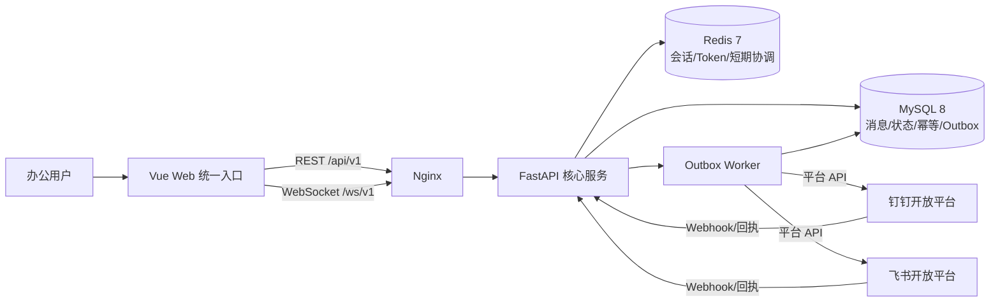

# 系统架构设计（初赛设计稿）

> 状态：设计稿，不代表实现或验证通过。

## 1. 架构目标

围绕 Must 闭环构建模块化单体：平台差异被 Adapter 隔离，核心服务只处理统一消息、状态机、幂等和状态回流；前端通过冻结 API 契约访问后端。

## 2. 总体架构

## 3. 模块职责

| 模块 | 职责 | 边界 |
|---|---|---|
| Web 统一入口 | 登录、消息流、待办、处理、回复、状态查看、异常提示 | 只调用 `/api/v1` 与 `/ws/v1`，不直连数据库，不保存平台密钥 |
| API 服务 | 认证、查询、处理、回复受理、Webhook 验签与受理 | 只写入设计状态和 outbox，不在请求线程内做长耗时平台调用 |
| Adapter | 平台事件验签、格式转换、API 发送、回执解析 | 对上只暴露统一消息与发送接口 |
| 状态机服务 | 控制消息状态合法流转并写状态历史 | 禁止跨状态跳跃；异常状态可追踪 |
| Outbox Worker | 读取待发送事件、调用平台 API、处理重试与补偿 | 与业务写入同事务产生，重启后可恢复 |
| MySQL | 消息事实、状态历史、幂等约束、outbox | 唯一业务事实源 |
| Redis | 会话、Token 缓存、短期限流/协调 | 不作为消息或幂等事实源 |

## 4. 关键链路

1. 平台 Webhook 到达后先验签，再转换为统一消息，以 `(platform, platform_event_id)` 唯一约束去重。
2. 消息入库后推送 WebSocket；前端断线时通过消息游标补拉。
3. 用户处理消息时提交当前 `version`，后端使用乐观锁避免并发覆盖。
4. 用户回复时写入出站消息、状态历史和 outbox；请求立即返回 `replying`。
5. Worker 调平台 API；发送成功进入 `replied`，失败进入 `send_failed` 并按退避策略重试。
6. 真实回执或主动查询补偿成功后才进入 `confirmed`，状态通过 WebSocket 回流页面。

## 5. 部署形态

Docker Compose 包含六个服务：

| 服务 | 内容 |
|---|---|
| `web` | Vue 静态资源构建产物 |
| `api` | FastAPI REST、Webhook 与 WebSocket |
| `worker` | outbox 发送、重试与补偿任务 |
| `mysql` | MySQL 8 与持久卷 |
| `redis` | Redis 7 与持久卷 |
| `nginx` | 前端托管、反向代理、HTTPS 终止 |

该部署图用于初赛设计；纯净 Linux 从零部署演练属于后续验证事项，尚未执行。