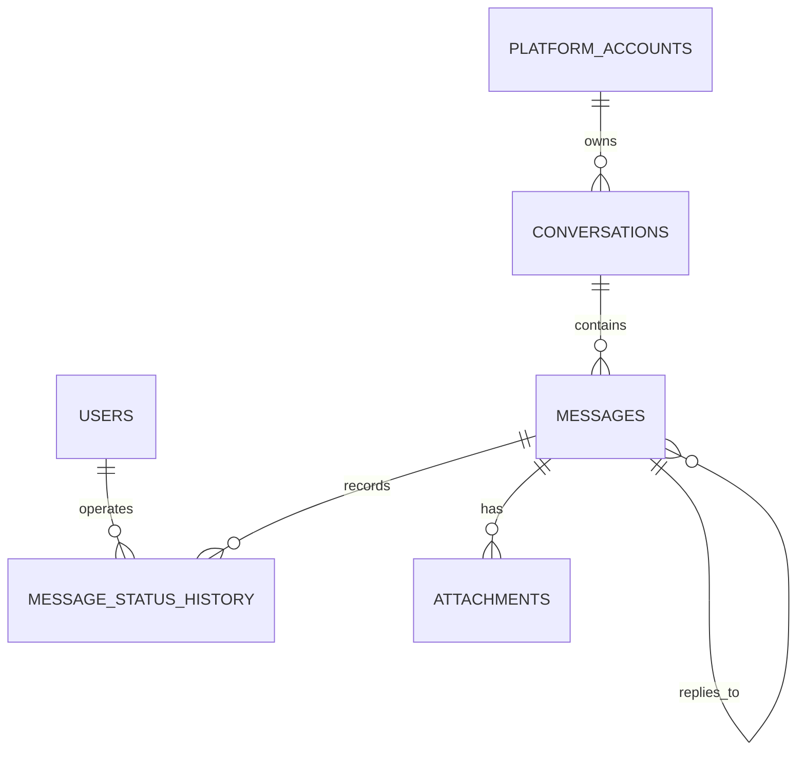

# 数据模型设计（初赛设计稿）

> 状态：设计稿，DDL 位于 `contracts/schema.sql`，不代表数据库已部署。

## 1. 表关系

## 2. 表清单

| 序号 | 数据表名 | 作用 | 与其他表关系 |
|---:|---|---|---|
| 1 | `users` | 保存统一入口登录用户 | 操作行为以 actor 名称进入状态历史 |
| 2 | `platform_accounts` | 保存平台应用与凭证引用 | 一个平台账号对应多个会话 |
| 3 | `conversations` | 统一保存飞书/钉钉会话 | 属于平台账号，包含多条消息 |
| 4 | `messages` | 保存统一消息、方向、状态与版本 | 属于会话，可回复其他消息 |
| 5 | `attachments` | 保存文件附件元数据 | 属于消息 |
| 6 | `message_status_history` | 保存每次状态流转，并以其自增 ID 作为全局事件游标 | 属于消息 |
| 7 | `outbox_events` | 保存待发送与补偿事件 | 通过聚合 ID 关联消息 |

## 3. 关键约束

- `(platform, platform_event_id)`：平台事件幂等去重。
- `(platform, conversation_id, client_request_id)`：客户端回复请求幂等。
- `messages.version`：用户处理与回复时用于乐观锁。
- `idx_status_feedback`：支持按平台、会话、状态和时间查询回流结果。
- `outbox_events.idempotency_key`：保证待发送事件不会因重启而重复创建。
- `message_status_history.id`：全局递增，作为 WebSocket 与 REST 断线补拉游标；新消息入库时至少写入一条初始历史。
- `users` 与状态历史中的 `actor` 为审计口径的逻辑关联，不设置外键；`outbox_events.aggregate_id` 在 `aggregate_type=message` 时逻辑关联 `messages.id`，不设置跨聚合外键。

## 4. 字段说明

完整字段、类型、中文名和解释以提交版 `03_数据库设计` 为准；可执行建表语句以 `contracts/schema.sql` 为准。