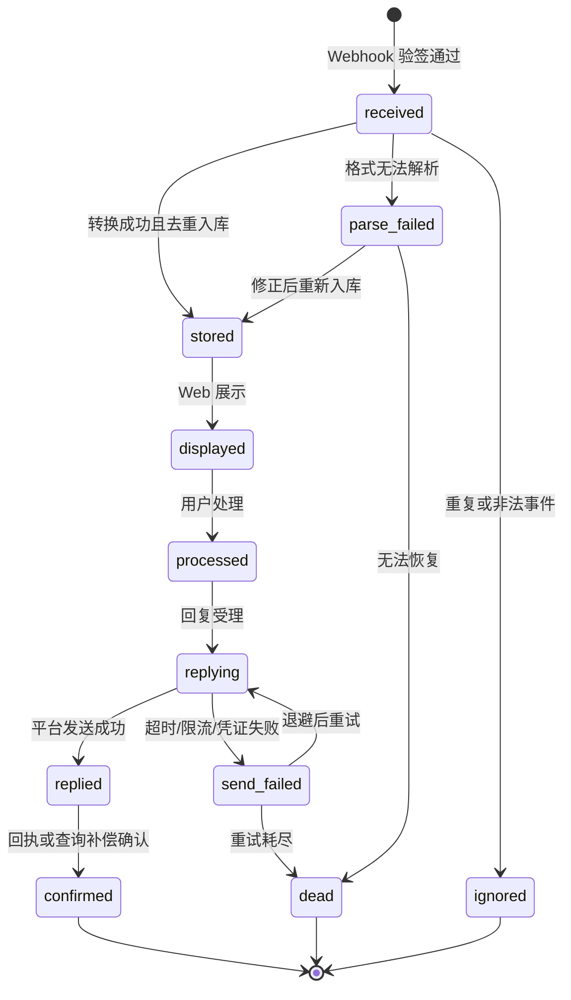

# 消息状态机设计（初赛设计稿）

> 状态：设计稿，不代表实现或验证通过。

## 1. 状态定义

| 状态 | 含义 |
|---|---|
| `received` | 平台事件到达且验签通过 |
| `stored` | 已转换、去重并入库 |
| `displayed` | 已推送或被前端拉取展示 |
| `processed` | 用户已在统一入口完成处理 |
| `replying` | 用户回复已受理，等待平台发送 |
| `replied` | 平台发送接口返回成功 |
| `confirmed` | 平台回执或主动查询确认成功 |
| `parse_failed` | 消息无法解析，进入异常队列 |
| `ignored` | 重复或非法事件被忽略 |
| `send_failed` | 发送失败，可重试或转人工 |
| `dead` | 重试耗尽或无法恢复，归档处理 |

## 2. 状态图

## 3. 不变量

1. 每次状态变化写入 `message_status_history`。
2. 用户处理和回复必须校验 `version`，防止并发覆盖。
3. `replying` 不表示平台侧已收到；只有 `replied` 和 `confirmed` 可以分别表示发送成功与回流确认。
4. WebSocket 推送失败不改变业务状态；前端恢复后通过游标补拉。
5. 平台重复事件只更新审计日志，不产生重复消息。