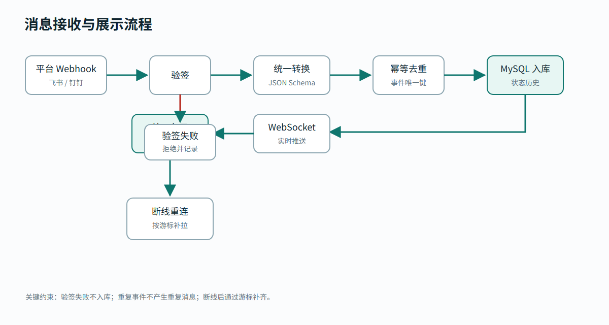
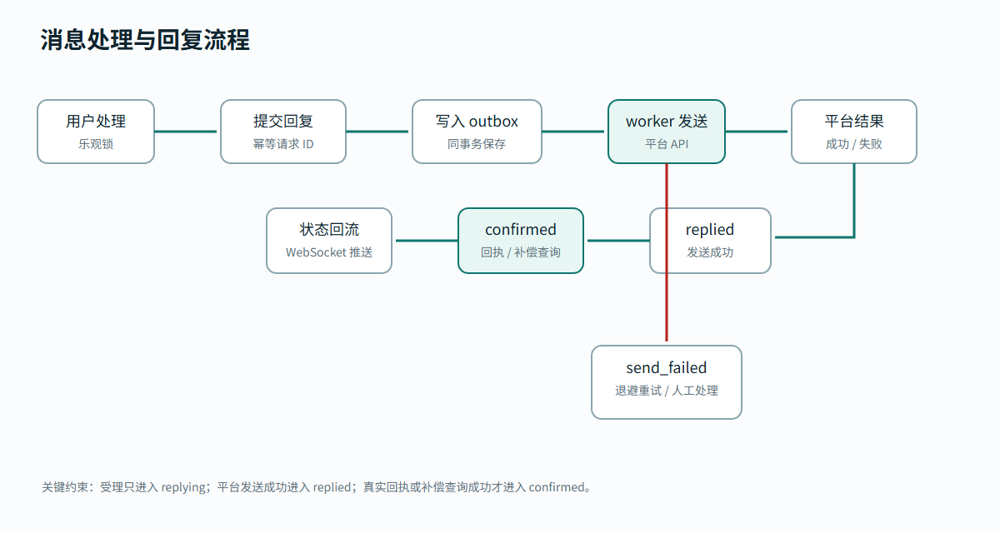
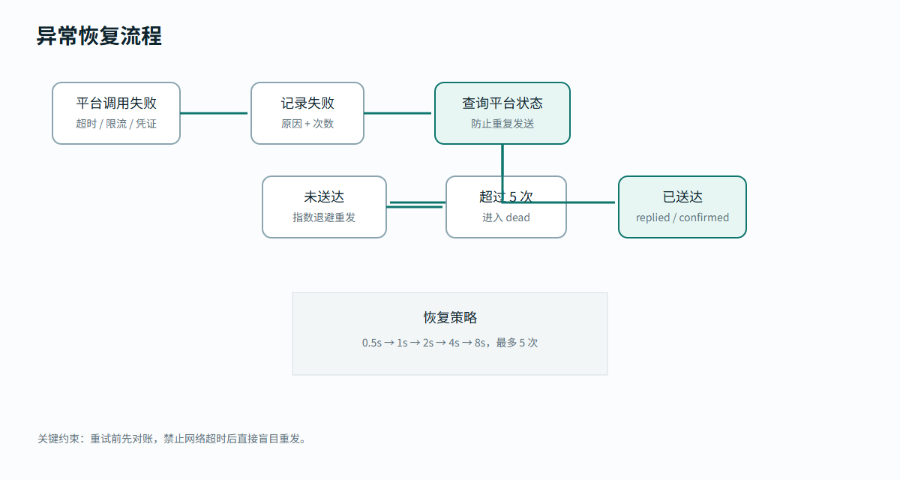

# 需求分析

> 项目名称：UnifiedMessagesManagement（多平台连接器与统一消息管理）
> 报名序号：47
> 队伍人员：队长廖俊健，队员姚峰
> 状态：提交源稿；设计内容不代表已实现或验证通过。

## 1. 需求理解

多平台办公场景下，消息分散在飞书、钉钉等不同客户端，用户需要反复切换入口才能查看、处理和回复，容易造成遗漏、延迟和状态不一致。本项目的核心不是简单聚合消息，而是建立一个统一消息管理入口：系统通过官方 API 或 Webhook 接收平台事件，将不同平台的消息格式转换为内部统一模型，在 Web 页面集中展示，并允许用户直接处理与回复。回复结果需要回到对应平台，处理、发送、失败和确认状态也要回流到统一入口，形成“接收 → 展示 → 处理 → 回复 → 状态回流”的可追踪闭环。

需求设计以两个平台为基础，优先保证文本与文件消息、待办聚合、幂等去重、断线恢复和异常状态可处理。系统还需要控制平台凭证和入口访问安全，避免未授权用户查看或发送消息。AI 摘要、第三平台扩展和高可用属于后续增强方向，不影响初赛主闭环。

## 2. 功能清单

| 序号 | 功能项 | 功能描述 |
|---:|---|---|
| 1 | 多平台连接器接入 | 通过统一 Adapter 接口接入飞书、钉钉，对上屏蔽平台 API 与消息格式差异。 |
| 2 | 平台消息接收 | 接收平台 Webhook 事件，完成验签、解析、受理和异常识别。 |
| 3 | 统一消息格式转换 | 将平台消息映射为内部标准格式，并支持内部格式反向转换为平台发送格式。 |
| 4 | 消息持久化与幂等去重 | 保存消息、会话、状态和附件；通过平台事件 ID 与回复请求 ID 避免重复记录。 |
| 5 | Web 统一入口 | 集中展示不同平台消息、会话和处理状态，支持查看、筛选与详情追踪。 |
| 6 | 实时消息推送 | 新消息与状态变化通过 WebSocket 推送，断线后按游标补拉。 |
| 7 | 统一入口回复 | 用户可在统一入口向指定平台发送文本或文件回复，并查看受理、成功或失败结果。 |
| 8 | 状态机与状态回流 | 管理接收、展示、处理、回复、确认及异常状态，平台结果回写到统一入口。 |
| 9 | 待办事项聚合 | 汇聚各平台待办事项，统一展示来源、内容、时间和处理状态。 |
| 10 | 入口认证与会话控制 | 统一入口登录鉴权，会话超时自动失效，未认证请求不得访问业务接口。 |

## 3. 新增功能

以下“新增”指相对于题目明确基础条目的设计增强，均为当前设计内容，不表示已实现或验证通过。

| 序号 | 功能项 | 功能描述 | 为何新增 |
|---:|---|---|---|
| 1 | 回复请求幂等 | 客户端每次回复生成唯一请求 ID，数据库以唯一约束防止网络重试或重复点击造成重复回复。 | 题目要求发送反馈，但实际网络可能重试；幂等设计能避免同一回复被平台重复接收。 |
| 2 | 状态历史追踪 | 每次状态变化记录来源状态、目标状态、时间、原因和操作者。 | 让“处理是否完成、回复是否送达、失败发生在哪一步”可以回放和审查。 |
| 3 | 断线游标补拉 | WebSocket 事件携带状态历史自增 ID 作为递增游标，断线重连后通过 REST 补齐新建消息和状态变化。 | 保证移动网络或服务重启后统一入口不漏消息。 |
| 4 | 持久化发送队列 | 回复受理后写入 outbox，由后台 worker 发送并支持重启恢复。 | 避免请求线程崩溃或服务重启导致已受理回复丢失。 |
| 5 | 异常队列与死信 | 解析失败、发送失败和重试耗尽分别进入可识别状态，支持人工复核。 | 防止异常消息静默丢失，提升闭环可靠性。 |

## 4. 核心流程

### 4.1 消息接收与展示流程

图 1 说明：平台事件先验签，再转换为统一消息。系统利用平台事件 ID 去重，只有新事件才写入数据库并推送页面；断线场景通过游标补拉恢复，避免消息丢失。

### 4.2 消息处理与回复流程

图 2 说明：用户处理与回复不会直接阻塞在平台调用上。系统先持久化回复请求，再由后台任务发送；平台成功、失败和最终确认均会回流到页面。

### 4.3 异常恢复流程

图 3 说明：发送失败后不盲目重发。系统先查询平台侧状态，确认未送达才按退避策略重试，避免超时造成的重复回复。

## 5. 其他

AI 专项对话链接：待替换为真实、可公开访问且不含隐私信息的链接。

当前实现边界：据用户陈述，钉钉平台侧已具备真实收发、回调和回执，但证据尚未归档，当前未复核；飞书尚未接通；统一 Web 产品尚未实现。本章描述的是需求与设计范围，不把上述未完成事项写成已验证结果。