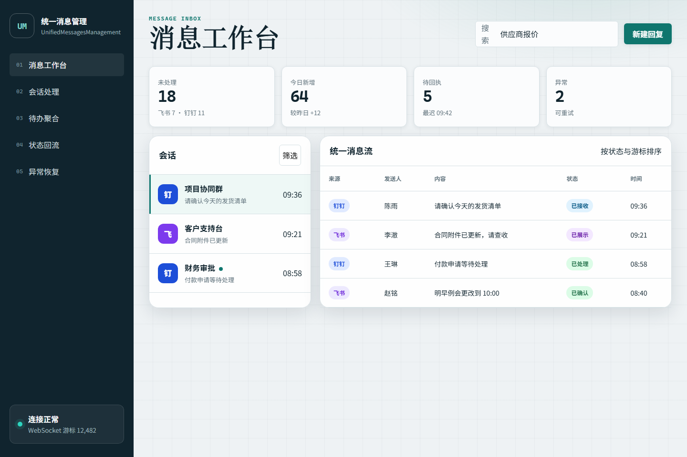
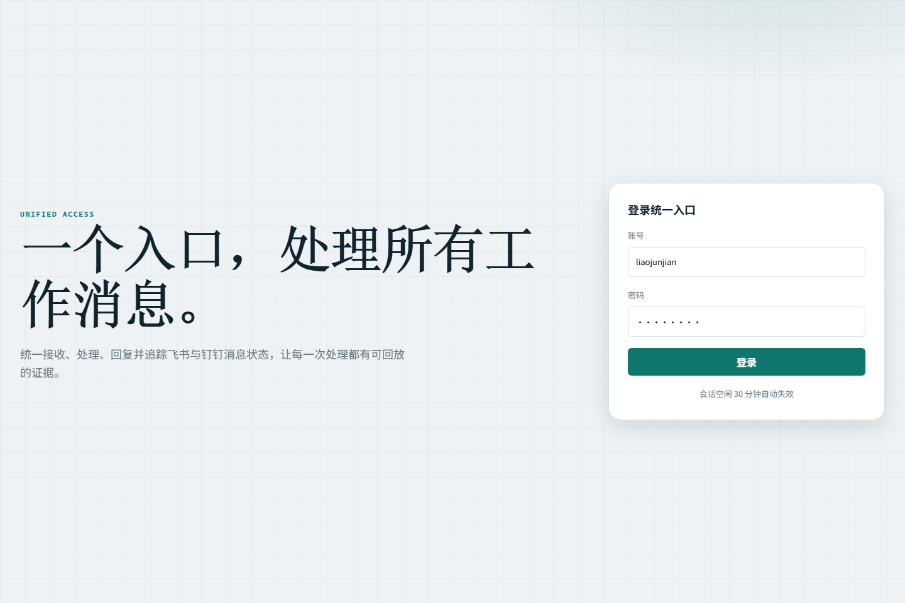
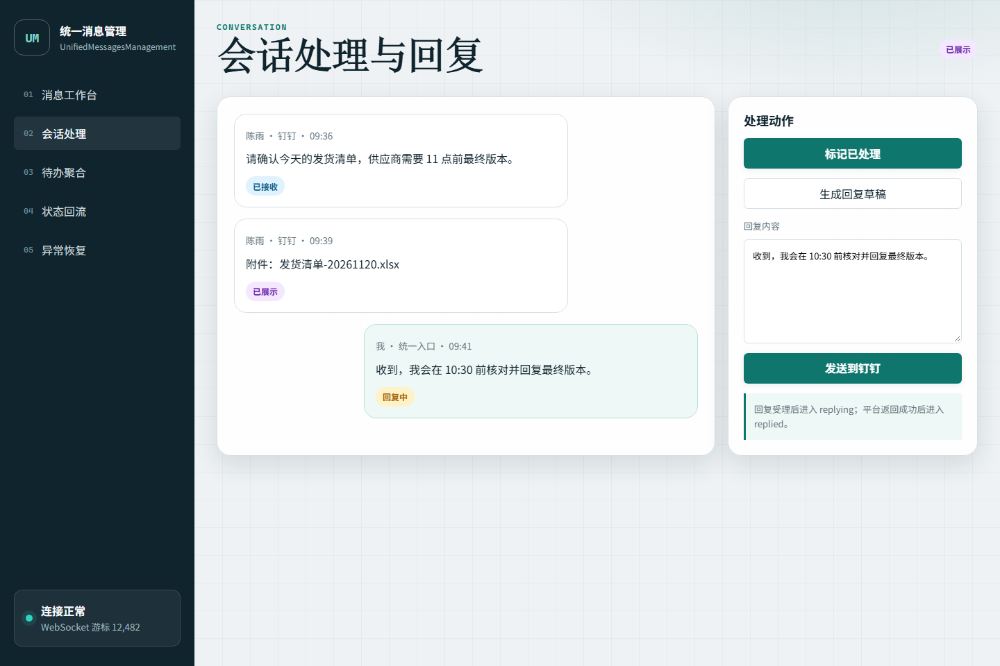
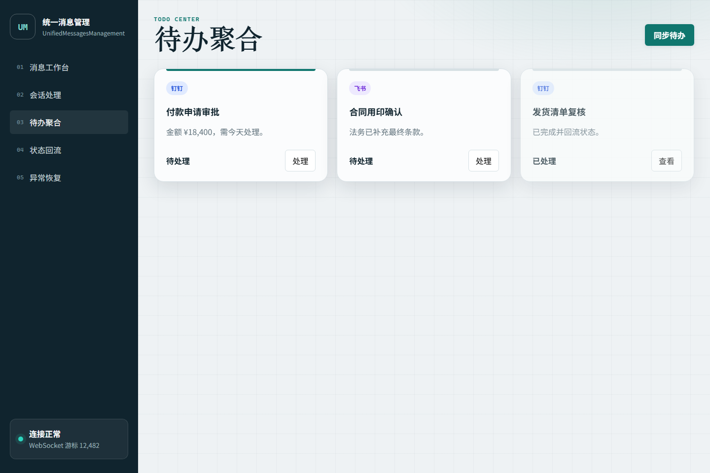
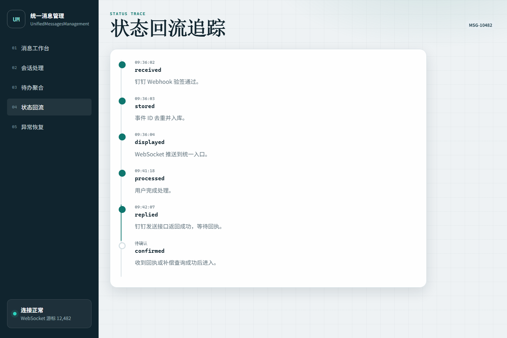
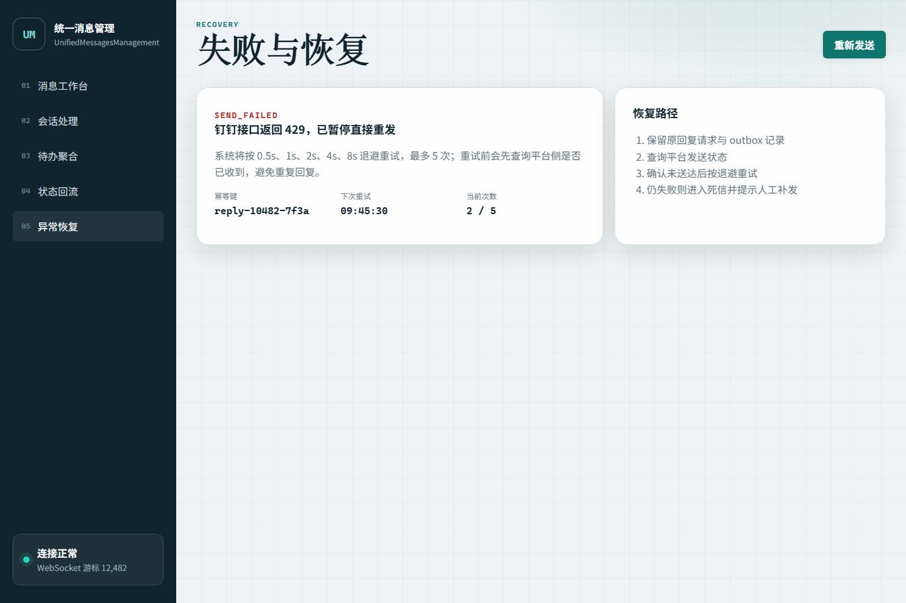
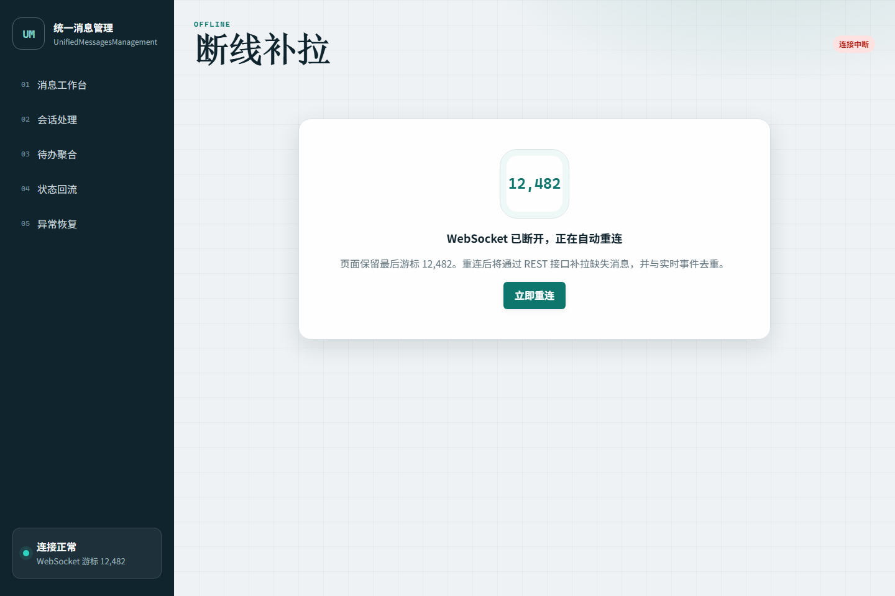
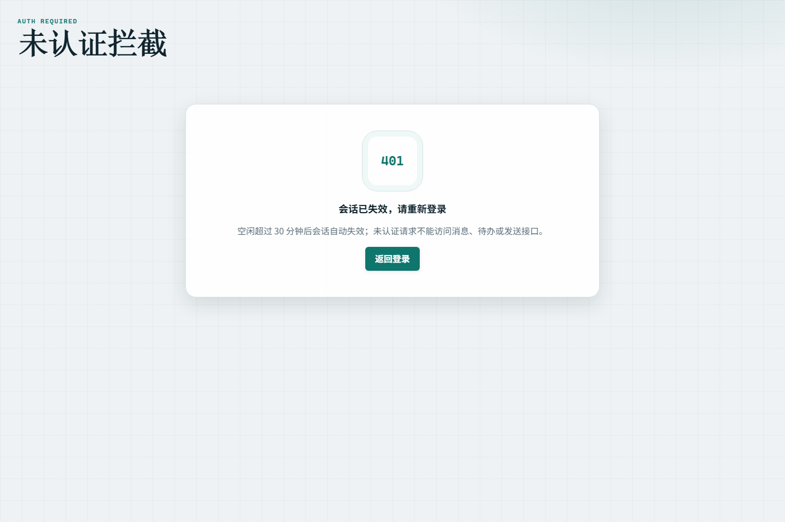

# 原型设计

> 项目名称：UnifiedMessagesManagement（多平台连接器与统一消息管理）
> 报名序号：47
> 队伍人员：队长廖俊健，队员姚峰
> 状态：原型设计稿；截图来自本地静态原型，不代表真实产品已实现。

## 1. 软件界面清单

| 序号 | 一级菜单 | 二级菜单 | 主要界面 |
|---:|---|---|---|
| 1 | 统一入口 | 登录认证 | 登录页、未认证拦截页 |
| 2 | 消息工作台 | 消息列表 | 消息工作台、消息筛选、消息详情 |
| 3 | 消息工作台 | 会话处理 | 会话处理与回复页 |
| 4 | 待办中心 | 待办列表 | 待办聚合页 |
| 5 | 状态中心 | 状态追踪 | 状态回流追踪页 |
| 6 | 异常中心 | 失败恢复 | 发送失败与恢复页 |
| 7 | 异常中心 | 连接恢复 | 断线补拉页 |

## 2. 界面内容

| 界面 | 主要展示内容 | 主要功能 |
|---|---|---|
| 登录页 | 项目名称、账号、密码、会话安全提示 | 登录、表单校验、错误提示 |
| 未认证拦截页 | 401 状态、会话失效原因、重新登录入口 | 阻止未认证访问、返回登录 |
| 消息工作台 | 未处理数、今日新增、待回执、异常数、会话列表、统一消息流 | 搜索、筛选、查看消息、进入会话 |
| 会话处理与回复页 | 平台来源、消息内容、附件、当前状态、回复输入框 | 标记处理、发送文本/文件回复、查看发送中状态 |
| 待办聚合页 | 待办来源、标题、摘要、处理状态 | 同步待办、处理待办、查看结果 |
| 状态回流追踪页 | 消息 ID、状态时间线、当前节点、后续节点 | 回放状态、定位失败节点、确认平台回流 |
| 发送失败与恢复页 | 错误码、失败原因、幂等键、重试次数、下次重试时间 | 重试、查看恢复路径、转人工处理 |
| 断线补拉页 | 最后游标、连接状态、补拉说明 | 自动重连、手动重连、补拉缺失消息 |

## 3. 界面设计

### 图 1 消息工作台

图 1 展示统一入口的主工作台，左侧为导航与会话，右侧为指标、来源标识、消息内容和状态。用户可以从消息列表进入处理页面。

### 图 2 登录页

图 2 展示统一入口登录界面。界面明确项目名称与系统价值，登录表单包含账号、密码和会话超时提示。

### 图 3 会话处理与回复

图 3 展示消息详情、平台来源、附件、回复输入和发送动作。回复受理后先显示“回复中”，不提前假报平台侧已成功。

### 图 4 待办聚合

图 4 展示跨平台待办卡片，包含来源、标题、摘要和状态，便于用户统一安排处理。

### 图 5 状态回流追踪

图 5 展示单条消息从接收、入库、展示、处理、回复到确认的时间线，支撑闭环追踪。

### 图 6 发送失败与恢复

图 6 展示平台限流或发送失败时的错误原因、幂等键、重试次数和恢复路径，避免用户误解为已发送成功。

### 图 7 断线补拉

图 7 展示 WebSocket 断开后的最后游标、自动重连和补拉说明，保证恢复后消息不遗漏。

### 图 8 未认证拦截

图 8 展示会话失效后的 401 拦截页面，未认证用户不能继续访问消息或发送接口。

## 4. 其他

AI 专项对话链接：待替换为真实、可公开访问且不含隐私信息的链接。

原型源文件位于 `web/prototype/`；截图仅用于界面设计说明，不作为真实运行验证证据。