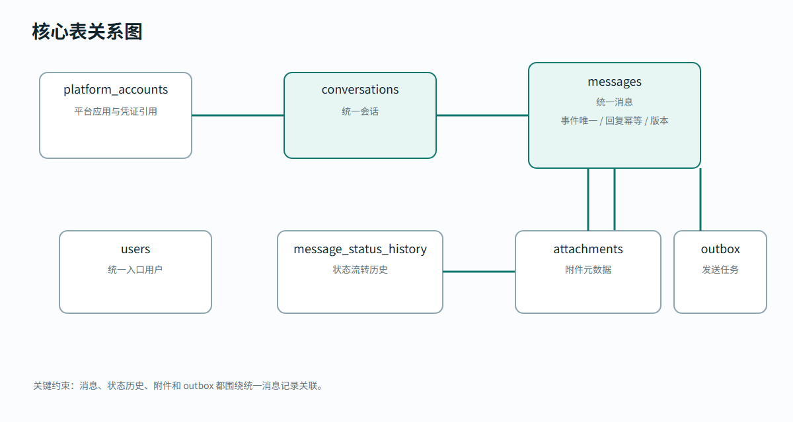

# 数据库设计

> 项目名称：UnifiedMessagesManagement（多平台连接器与统一消息管理）
> 报名序号：47
> 队伍人员：队长廖俊健，队员姚峰
> 状态：数据库设计稿；以 `contracts/schema.sql` 为准，不代表数据库已部署。

## 1. 数据表清单

| 序号 | 数据表名 | 作用 | 与其他表关系 |
|---:|---|---|---|
| 1 | `users` | 保存统一入口登录用户及口令散列 | 用户操作以 `actor` 审计名称逻辑关联状态历史，不设置外键 |
| 2 | `platform_accounts` | 保存飞书、钉钉应用账号与凭证引用 | 一个平台账号对应多个会话 |
| 3 | `conversations` | 保存统一会话及平台会话标识 | 属于平台账号，包含多条消息 |
| 4 | `messages` | 保存统一消息、方向、状态、幂等键和版本 | 属于会话，可关联回复目标消息 |
| 5 | `attachments` | 保存文件消息附件元数据 | 属于消息 |
| 6 | `message_status_history` | 保存状态流转历史，并以其自增 ID 作为全局事件游标 | 属于消息 |
| 7 | `outbox_events` | 保存待发送、重试和补偿事件 | `aggregate_type=message` 时以聚合 ID 逻辑关联消息，不设置跨聚合外键 |

## 2. 数据表内容

图 1 展示平台账号、会话、消息、附件、状态历史与发送事件之间的关联；用户操作通过状态历史中的操作者字段留痕。其中用户与状态历史、outbox 与消息属于审计或跨聚合场景下的逻辑关联，DDL 未设置这两类外键。

### 表 1 `users`

| 表名 | 序号 | 字段英文名 | 字段类型 | 字段中文名 | 字段解释 |
|---|---:|---|---|---|---|
| users | 1 | id | BIGINT UNSIGNED | 用户 ID | 主键，自增 |
| users | 2 | username | VARCHAR(64) | 登录名 | 唯一，不允许重复 |
| users | 3 | password_hash | VARCHAR(255) | 口令散列 | 不保存明文密码 |
| users | 4 | display_name | VARCHAR(128) | 显示名称 | 页面展示名称 |
| users | 5 | status | VARCHAR(16) | 用户状态 | active/disabled |
| users | 6 | created_at | DATETIME(6) | 创建时间 | 记录创建时间 |
| users | 7 | updated_at | DATETIME(6) | 更新时间 | 自动更新 |

### 表 2 `platform_accounts`

| 表名 | 序号 | 字段英文名 | 字段类型 | 字段中文名 | 字段解释 |
|---|---:|---|---|---|---|
| platform_accounts | 1 | id | BIGINT UNSIGNED | 账号 ID | 主键，自增 |
| platform_accounts | 2 | platform | VARCHAR(32) | 平台 | feishu/dingtalk |
| platform_accounts | 3 | account_name | VARCHAR(128) | 账号名称 | 测试企业或应用名称 |
| platform_accounts | 4 | app_id | VARCHAR(128) | 应用 ID | 平台应用标识 |
| platform_accounts | 5 | encrypted_credentials | TEXT | 加密凭证 | 保存加密后的凭证材料 |
| platform_accounts | 6 | webhook_secret_ref | VARCHAR(255) | Webhook 密钥引用 | 指向安全配置，不明文展示 |
| platform_accounts | 7 | status | VARCHAR(16) | 启用状态 | enabled/disabled |
| platform_accounts | 8 | token_expires_at | DATETIME(6) | Token 过期时间 | 用于临期刷新 |
| platform_accounts | 9 | created_at | DATETIME(6) | 创建时间 | 记录创建时间 |
| platform_accounts | 10 | updated_at | DATETIME(6) | 更新时间 | 自动更新 |

### 表 3 `conversations`

| 表名 | 序号 | 字段英文名 | 字段类型 | 字段中文名 | 字段解释 |
|---|---:|---|---|---|---|
| conversations | 1 | id | BIGINT UNSIGNED | 会话 ID | 主键，自增 |
| conversations | 2 | platform | VARCHAR(32) | 平台 | 消息来源平台 |
| conversations | 3 | platform_conversation_id | VARCHAR(128) | 平台会话 ID | 与平台组成唯一键 |
| conversations | 4 | account_id | BIGINT UNSIGNED | 平台账号 ID | 外键关联平台账号 |
| conversations | 5 | title | VARCHAR(255) | 会话标题 | 群名或联系人名称 |
| conversations | 6 | conversation_type | VARCHAR(16) | 会话类型 | direct/group/todo |
| conversations | 7 | last_message_at | DATETIME(6) | 最近消息时间 | 用于会话排序 |
| conversations | 8 | created_at | DATETIME(6) | 创建时间 | 记录创建时间 |
| conversations | 9 | updated_at | DATETIME(6) | 更新时间 | 自动更新 |

### 表 4 `messages`

| 表名 | 序号 | 字段英文名 | 字段类型 | 字段中文名 | 字段解释 |
|---|---:|---|---|---|---|
| messages | 1 | id | BIGINT UNSIGNED | 消息 ID | 主键，自增 |
| messages | 2 | schema_version | VARCHAR(16) | 消息格式版本 | 支撑字段演进 |
| messages | 3 | platform | VARCHAR(32) | 平台 | feishu/dingtalk |
| messages | 4 | platform_event_id | VARCHAR(191) | 平台事件 ID | 平台事件幂等键 |
| messages | 5 | platform_message_id | VARCHAR(191) | 平台消息 ID | 平台返回的消息标识 |
| messages | 6 | conversation_id | BIGINT UNSIGNED | 会话 ID | 外键关联会话 |
| messages | 7 | sender_platform_user_id | VARCHAR(128) | 发送者平台 ID | 平台侧用户标识 |
| messages | 8 | sender_name | VARCHAR(128) | 发送者名称 | 页面展示名称 |
| messages | 9 | message_type | VARCHAR(16) | 消息类型 | text/file/todo |
| messages | 10 | content_text | MEDIUMTEXT | 文本内容 | 统一文本内容 |
| messages | 11 | content_json | JSON | 结构化内容 | 保存平台映射后的结构 |
| messages | 12 | direction | VARCHAR(16) | 消息方向 | inbound/outbound |
| messages | 13 | status | VARCHAR(24) | 消息状态 | 状态机当前状态 |
| messages | 14 | reply_to_message_id | BIGINT UNSIGNED | 回复目标消息 | 自关联外键 |
| messages | 15 | client_request_id | VARCHAR(128) | 客户端请求 ID | 回复幂等键 |
| messages | 16 | version | INT UNSIGNED | 乐观锁版本 | 防止并发覆盖 |
| messages | 17 | occurred_at | DATETIME(6) | 发生时间 | 平台事件发生时间 |
| messages | 18 | created_at | DATETIME(6) | 创建时间 | 入库时间 |
| messages | 19 | updated_at | DATETIME(6) | 更新时间 | 最近状态更新时间 |

### 表 5 `attachments`

| 表名 | 序号 | 字段英文名 | 字段类型 | 字段中文名 | 字段解释 |
|---|---:|---|---|---|---|
| attachments | 1 | id | BIGINT UNSIGNED | 附件 ID | 主键，自增 |
| attachments | 2 | message_id | BIGINT UNSIGNED | 消息 ID | 外键关联消息 |
| attachments | 3 | file_name | VARCHAR(255) | 文件名 | 原始文件名 |
| attachments | 4 | mime_type | VARCHAR(128) | 文件类型 | MIME 类型 |
| attachments | 5 | size_bytes | BIGINT UNSIGNED | 文件大小 | 单位字节 |
| attachments | 6 | storage_path | VARCHAR(512) | 存储路径 | 本地或对象存储路径 |
| attachments | 7 | platform_file_id | VARCHAR(191) | 平台文件 ID | 平台素材标识 |
| attachments | 8 | checksum_sha256 | CHAR(64) | 文件校验值 | 用于完整性校验 |
| attachments | 9 | created_at | DATETIME(6) | 创建时间 | 入库时间 |

### 表 6 `message_status_history`

| 表名 | 序号 | 字段英文名 | 字段类型 | 字段中文名 | 字段解释 |
|---|---:|---|---|---|---|
| message_status_history | 1 | id | BIGINT UNSIGNED | 历史 ID | 主键，自增；作为断线补拉的全局事件游标 |
| message_status_history | 2 | message_id | BIGINT UNSIGNED | 消息 ID | 外键关联消息 |
| message_status_history | 3 | from_status | VARCHAR(24) | 原状态 | 首次写入可为空 |
| message_status_history | 4 | to_status | VARCHAR(24) | 目标状态 | 状态机新状态 |
| message_status_history | 5 | reason | VARCHAR(512) | 流转原因 | 记录失败或操作原因 |
| message_status_history | 6 | actor | VARCHAR(64) | 操作者 | system/user/worker |
| message_status_history | 7 | occurred_at | DATETIME(6) | 发生时间 | 状态发生时间 |
| message_status_history | 8 | created_at | DATETIME(6) | 入库时间 | 记录创建时间 |

### 表 7 `outbox_events`

| 表名 | 序号 | 字段英文名 | 字段类型 | 字段中文名 | 字段解释 |
|---|---:|---|---|---|---|
| outbox_events | 1 | id | BIGINT UNSIGNED | 事件 ID | 主键，自增 |
| outbox_events | 2 | aggregate_type | VARCHAR(32) | 聚合类型 | 例如 message |
| outbox_events | 3 | aggregate_id | BIGINT UNSIGNED | 聚合 ID | 关联业务记录 |
| outbox_events | 4 | event_type | VARCHAR(64) | 事件类型 | 例如 send_reply |
| outbox_events | 5 | payload_json | JSON | 事件内容 | 发送所需参数 |
| outbox_events | 6 | idempotency_key | VARCHAR(191) | 幂等键 | 防止重复创建任务 |
| outbox_events | 7 | status | VARCHAR(16) | 事件状态 | pending/sent/failed |
| outbox_events | 8 | attempts | INT UNSIGNED | 已尝试次数 | 控制最大重试 |
| outbox_events | 9 | next_retry_at | DATETIME(6) | 下次重试时间 | 退避调度依据 |
| outbox_events | 10 | processed_at | DATETIME(6) | 完成时间 | 成功或终止时间 |
| outbox_events | 11 | created_at | DATETIME(6) | 创建时间 | 入库时间 |
| outbox_events | 12 | updated_at | DATETIME(6) | 更新时间 | 自动更新 |

## 3. SQL语句

完整建表 SQL 与字段、约束和索引的最终版本见 `contracts/schema.sql`。提交版 Word 将按表拆分为独立 `CREATE TABLE` 语句，确保每张表均可独立审查。

## 4. 其他

AI 专项对话链接：待替换为真实、可公开访问且不含隐私信息的链接。