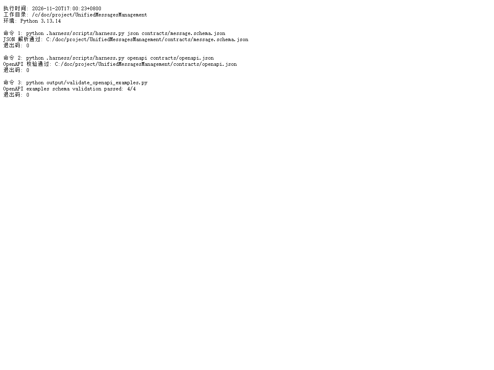
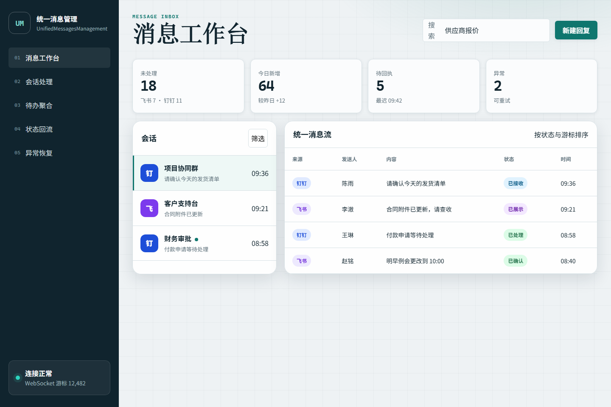

# 初步验证

> 项目名称：UnifiedMessagesManagement（多平台连接器与统一消息管理）
> 报名序号：47
> 队伍人员：队长廖俊健，队员姚峰
> 状态：验证资料模板与已复核工程证据汇总；未归档的平台截图不得写成已复核通过。

## 1. 技术选择

前端采用 Vue 3、TypeScript、Vite、Element Plus；后端采用 Python 3.12、FastAPI、Pydantic、SQLAlchemy 2、Alembic；数据库采用 MySQL 8；缓存采用 Redis 7；接口采用 REST `/api/v1`、WebSocket `/ws/v1`、OpenAPI 3.1 和 JSON Schema 2020-12；部署设计采用 Docker Compose 与 Nginx。

技术难点主要包括平台消息格式差异、Webhook 验签、重复事件去重、回复超时后的重复发送控制、WebSocket 断线补拉、平台回执补偿和凭证安全。AI 不进入初赛主闭环。

## 2. 验证清单

| 序号 | 验证内容 | 对应设计 | 验证方式 | 备注 |
|---:|---|---|---|---|
| 1 | 统一消息 Schema 可解析 | `contracts/message.schema.json` | 执行 JSON 解析校验 | 已通过 |
| 2 | OpenAPI 契约可解析 | `contracts/openapi.json` | 执行 OpenAPI 校验 | 已通过 |
| 3 | 原型界面可打开并截图 | `02_原型设计` | 本地静态服务 + 浏览器截图 | 已生成原型图 |
| 4 | 钉钉真实收发 | 平台消息接收、统一入口回复 | 平台侧截图、日志、消息 ID 与复跑步骤 | 待用户补充证据 |
| 5 | 钉钉真实回调 | Webhook 验签与受理 | 回调请求、验签结果、响应日志 | 待用户补充证据 |
| 6 | 钉钉真实回执 | 状态回流 | 回执记录、状态变化截图 | 待用户补充证据 |
| 7 | 飞书真实收发 | 多平台连接器 | 平台侧截图与复跑步骤 | 飞书未接通，暂缺 |
| 8 | 统一 Web 闭环 | 接收 → 展示 → 处理 → 回复 → 回流 | 可运行产品页面截图与日志 | 产品未实现，暂缺 |
| 9 | 干净环境启动 | 代码仓库与运行说明 | 干净 checkout、启动命令、健康检查 | 产品代码暂缺 |

## 3. 验证结果

### 3.1 统一消息 Schema 解析

| 项目 | 结果 |
|---|---|
| 执行时间 | 2026-11-20 17:00:23 +0800 |
| 环境 | Windows，Python 3.13.14 |
| 命令 | `python .harness/scripts/harness.py json contracts/message.schema.json` |
| 实际输出 | `JSON 解析通过` |
| 退出码 | 0 |
| 结果 | 契约解析通过；仅证明消息 Schema 格式可解析，不代表消息服务已实现。 |
| 证据 | `docs/submissions/assets/validation/evidence-05-contract-validation-01.txt` |

### 3.2 OpenAPI 契约与示例校验

| 项目 | 结果 |
|---|---|
| 执行时间 | 2026-11-20 17:00:23 +0800 |
| 环境 | Windows，Python 3.13.14 |
| 命令 1 | `python .harness/scripts/harness.py openapi contracts/openapi.json` |
| 命令 2 | `python output/validate_openapi_examples.py` |
| 实际输出 | `OpenAPI 校验通过`；`OpenAPI examples schema validation passed: 4/4` |
| 退出码 | 0；0 |
| 结果 | 契约解析通过，4 个关键响应示例与对应 Schema 的必填字段、类型、枚举和属性闭合一致；不代表接口已实现。 |
| 证据 | `docs/submissions/assets/validation/evidence-05-contract-validation-01.txt` |

图 1 展示统一消息 Schema、OpenAPI 和 4 个关键响应示例的真实命令、输出及退出码。原始日志与截图位于同一证据目录。

### 3.3 原型界面截图

已生成 8 张原型截图，位于 `docs/submissions/assets/prototype/`。以下展示其中一张可复核证据，证明原型设计稿可打开、布局和主要状态可见；这些截图不作为真实产品运行证据。

图 2 展示消息工作台原型在本地浏览器中的实际呈现。完整 8 张界面图已纳入 `02_原型设计`。

### 3.4 钉钉平台侧验证

用户已确认钉钉存在真实收发、回调和回执，但尚未提供可归档截图、日志、消息 ID、执行步骤、执行时间和环境信息。本节保留以下证据位，待用户提供后填写：

- 图：钉钉真实消息发送与接收截图（待补充）。
- 图：Webhook 回调与验签日志截图（待补充）。
- 图：平台回执与状态记录截图（待补充）。
- 复跑步骤、命令、退出码和证据路径（待补充）。

在证据归档前，不能把“钉钉平台侧已接通”写成统一产品闭环验证通过。

### 3.5 飞书与统一 Web 闭环

飞书尚未接通，统一 Web 产品尚未实现，因此无真实闭环截图。后续必须以同一测试消息串联平台回调、页面展示、用户处理、统一入口回复、平台侧接收和状态回流。

## 4. 其他

AI 专项对话链接：待替换为真实、可公开访问且不含隐私信息的链接。