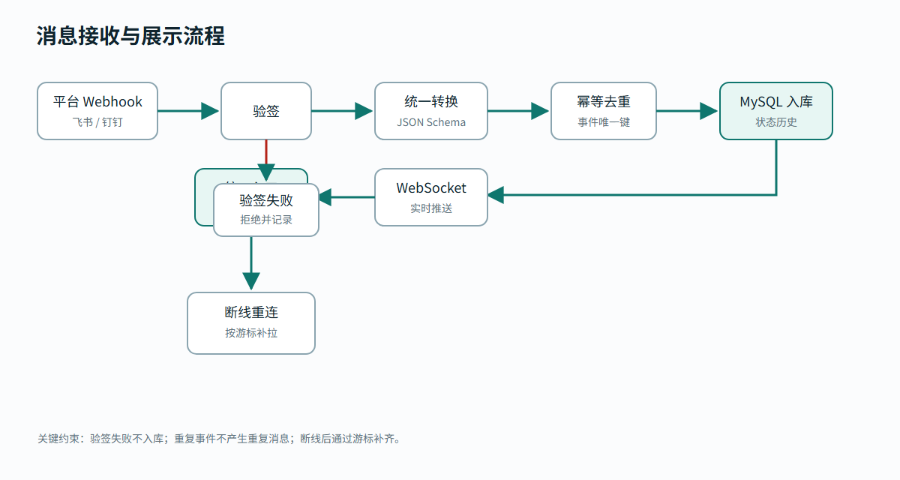
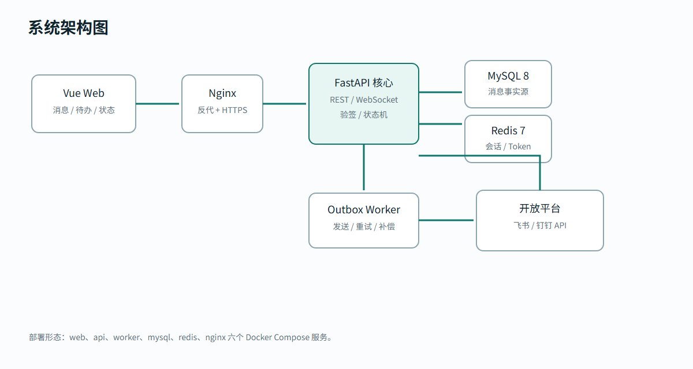
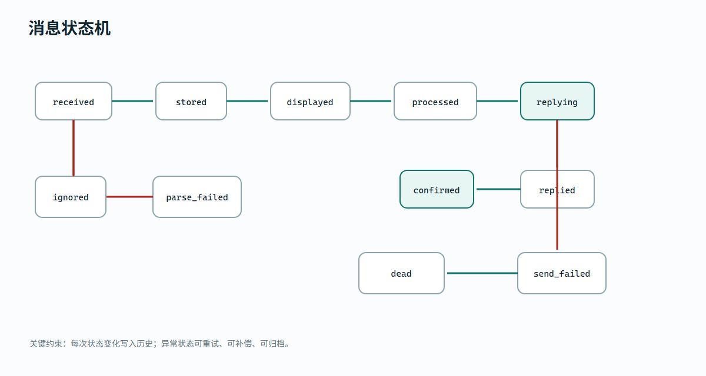

# 设计文档精简版

> 项目名称：UnifiedMessagesManagement（多平台连接器与统一消息管理）
> 报名序号：47
> 队伍人员：队长廖俊健，队员姚峰
> 状态：精简设计源稿；目标为最终 PDF 不超过 10 页。

## 1. 业务闭环

系统通过平台 Webhook 接收飞书、钉钉消息，转换为统一格式并入库，在 Web 入口集中展示。用户处理和回复后，系统将回复转换为平台格式并发送，平台成功、失败和回执结果再回流到统一入口。

## 2. 系统架构

采用模块化单体：Vue 3 + Element Plus 前端，FastAPI 后端，MySQL 8 保存业务事实，Redis 7 保存会话与短期协调数据，worker 处理 outbox 发送与补偿，Nginx 托管前端并反代 REST/WebSocket。

## 3. 核心接口

| 接口 | 方法/协议 | 用途 |
|---|---|---|
| `/api/v1/auth/login` | POST | 登录统一入口 |
| `/api/v1/messages` | GET | 查询统一消息 |
| `/api/v1/messages/{messageId}` | GET | 查看详情和状态历史 |
| `/api/v1/messages/{messageId}/process` | POST | 标记处理 |
| `/api/v1/messages/{messageId}/reply` | POST | 受理回复 |
| `/api/v1/messages/{messageId}/retry` | POST | 重试失败发送 |
| `/api/v1/todos` | GET | 查询待办 |
| `/webhooks/{platform}` | POST | 接收平台事件 |
| `/ws/v1` | WebSocket | 推送新消息与状态变化 |

## 4. 关键表结构

| 表 | 作用 | 关键约束 |
|---|---|---|
| `users` | 登录用户 | 用户名唯一 |
| `platform_accounts` | 平台应用与凭证引用 | 平台 + 账号唯一 |
| `conversations` | 统一会话 | 平台 + 平台会话 ID 唯一 |
| `messages` | 统一消息与状态 | 平台事件唯一、回复请求唯一、版本乐观锁 |
| `attachments` | 文件元数据 | 关联消息 |
| `message_status_history` | 状态流转历史 | 关联消息 |
| `outbox_events` | 发送与补偿任务 | 幂等键唯一 |

## 5. 状态机

状态包括 `received`、`stored`、`displayed`、`processed`、`replying`、`replied`、`confirmed`、`parse_failed`、`ignored`、`send_failed`、`dead`。只有真实回执或平台查询补偿成功后才进入 `confirmed`，不能用本地推测代替。

## 6. 当前边界

据用户陈述，钉钉平台侧已具备真实收发、回调和回执，但截图、日志和复跑记录尚未归档，因此当前未复核。飞书未接通；统一 Web 产品尚未实现。AI 不进入初赛主闭环。