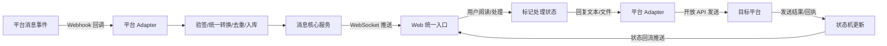
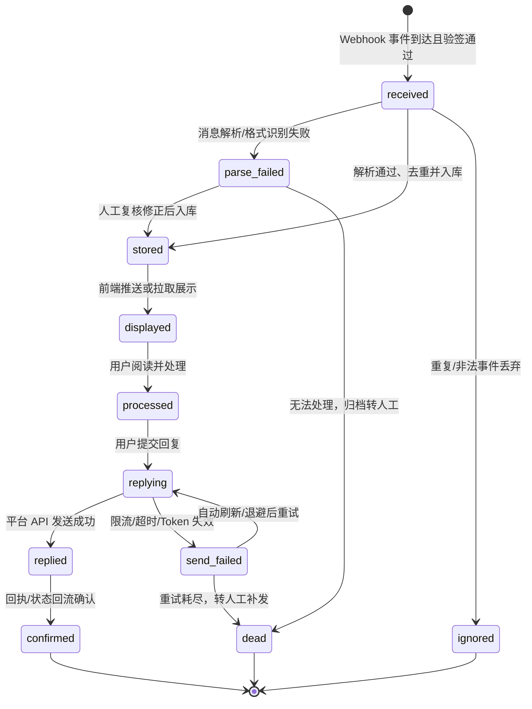

# 统一消息管理系统 · 需求分析文档

| 项 | 内容 |
|---|---|
| 项目名称 | UnifiedMessagesManagement（多平台连接器与统一消息管理） |
| 文档名称 | 需求分析文档 |
| 文档版本 | v1.1 |
| 编制角色 | RA-Agent（需求分析师） |
| 编制日期 | 2026-11-10（已与系统当前日期核对） |
| 适用阶段 | Phase 1 需求分析 → 质量门 G1 |
| 需求基线 | 《智能应用创新开发大赛_比赛设计文档》赛题 A 原文 |

## 修订记录

| 版本 | 日期 | 修订人 | 修订内容 |
|---|---|---|---|
| v1.0 | 2026-11-10 | RA-Agent | 首次发布，整合用户旅程、功能需求、非功能需求、追溯矩阵与可行性分析 |
| v1.1 | 2026-11-10 | RA-Agent | 依据 ISO/IEC/IEEE 29148 可靠性审查修订：量化 NFR 阈值（P1）、新增入口认证 NFR-13（P2）、补全追溯矩阵与高可用 FR-12（P3）、状态机补 parse_failed（P4）、补容量假设（P5）、清理非断言性验收标准（P6）、风险量化（P7）及 P8～P12 轻微项 |

---

## 1. 项目概述

### 1.1 项目背景

在数字化办公场景中，用户日常需同时使用飞书、钉钉、企业微信等多个办公/社交平台处理消息与待办，由此产生三类高频问题：

1. **平台割裂**：消息分散在不同客户端，用户需频繁切换，遗漏与响应滞后时有发生；
2. **格式差异**：各平台消息体结构、字段、事件机制各不相同，无法统一处理；
3. **缺乏闭环**：现有方案多为单向接收或简单转发，用户无法在一个入口完成"阅读—处理—回复—状态确认"的完整链路。

本项目对应智能应用创新开发大赛 **赛题 A：多平台连接器与统一消息管理**，要求开发一个连接器系统，统一接入多个平台，实现消息的集中管理、统一转换与发送反馈，并形成完整业务闭环。

### 1.2 项目目标

| 目标层级 | 目标描述 |
|---|---|
| 业务目标 | 用户在单一 Web 入口即可完成飞书、钉钉等多平台消息的接收、查看、处理与回复，消除平台切换成本 |
| 功能目标 | 对接至少 2 个平台；实现消息双向互通、统一格式转换、待办聚合与状态回流 |
| 工程目标 | 以适配器模式保证可扩展，提供 Docker 独立部署能力，在纯净服务器零依赖启动 |
| 比赛目标 | 满足初赛（11/20）可行性与验证证据要求，决赛（12/20）完整呈现业务闭环并支撑现场答辩 |

### 1.3 项目范围

**范围内（In Scope）**

- 飞书、钉钉两个平台的官方开放 API / Webhook 双向对接；
- Web 统一入口：多平台消息流集中展示、文本与文件消息发送、实时推送、登录认证；
- 平台消息体与内部标准消息格式的双向转换适配；
- 消息接收 → 统一展示 → 处理 → 发送反馈 → 状态回流的完整业务闭环；
- 跨平台待办事项聚合（Should 级）；
- 企业微信第三平台、AI 消息摘要、高可用设计等加分项（Could 级，视进度实施）；
- Docker / Docker Compose 独立部署包与部署文档。

**范围外（Out of Scope）**

- 微信个人号对接（无合规官方开放 API，不纳入）；
- 移动端原生 App（本期仅提供 Web 入口，移动端浏览器可访问）；
- 音视频通话、平台审批/日历/考勤等消息之外的深度业务功能；
- RPA 模拟操作方式：仅作为平台 API 不可用时的**备选方案**记录，不作为主实现路径；
- 对人员的追踪或信息收集：本系统仅做工程层面的消息与进度管理，全程合规。

### 1.4 术语与缩略语

| 术语 | 说明 |
|---|---|
| Adapter / 连接器 | 封装单一平台 API 差异、对上提供统一接口的适配模块 |
| Webhook | 平台向本系统推送事件的 HTTP 回调机制 |
| Schema | 内部标准消息体的字段结构规范 |
| 状态机 | 约束消息在其生命周期内合法状态与流转规则的模型 |
| 幂等（Idempotency） | 同一请求重复执行多次，结果与执行一次一致 |
| 乐观锁 | 通过版本号/条件更新实现并发控制，保证并发处理状态一致 |
| WebSocket | 服务端向浏览器主动推送消息的长连接协议 |
| Access Token | 调用平台开放 API 所需的访问凭证，通常有有效期 |
| SLO | 服务水平目标，量化的性能/可靠性阈值 |
| MoSCoW | 需求优先级方法：Must / Should / Could / Won't |
| NFR | Non-Functional Requirement，非功能需求 |
| RPA | 机器人流程自动化，模拟桌面端鼠标键盘操作 |
| DoD | Definition of Done，任务完成的验收标准 |
| FR / NFR | 功能需求编号 / 非功能需求编号 |

---

## 2. 干系人分析

| 干系人 | 关注点 | 对系统的诉求 | 诉求优先级 |
|---|---|---|---|
| 终端用户（多平台办公人员） | 消息不遗漏、处理高效、回复可靠、入口安全 | 单一入口、实时性、发送状态可见、操作简单、登录可控 | 高 |
| 开发团队（RA/Arch/Dev/QA/DevOps 各 Agent + 人工） | 契约清晰、模块解耦、可并行开发 | 适配器接口稳定、Schema 与 API 契约先行冻结 | 高 |
| 平台方（飞书 / 钉钉开放平台） | 调用合规、频率受控、回调安全 | 遵守权限范围与限流规则、正确处理验签与令牌 | 中 |
| 比赛评委（决策性客户） | 业务闭环、独立部署、文档质量、安全无漏洞 | 端到端可演示、纯净环境可部署、需求与实现可追溯、安全可解释 | 高 |
| 部署环境（纯净 Linux 服务器） | 零依赖、可重复启动 | Docker 镜像自包含、配置外部化、健康检查可探活 | 中 |

---

## 3. 用户角色与典型场景

### 3.1 用户画像

| 角色 | 特征 | 核心诉求 |
|---|---|---|
| 多平台办公用户（主要角色） | 同时使用飞书、钉钉处理工作消息与待办，每天在多个客户端间反复切换 | 一处看全、一处处理、一处回复、状态可确认 |

**权限模型说明**：系统默认单用户/单团队使用，不做复杂多角色权限产品化；但统一入口本身必须具备登录认证（见 NFR-13），平台账号与凭证由系统配置管理。

### 3.2 核心用户故事（User Story）

| 编号 | 用户故事 | 对应需求 |
|---|---|---|
| US-01 | 作为办公用户，我希望在一个网页中看到来自飞书和钉钉的全部新消息，无需切换客户端 | FR-01、FR-02、FR-05 |
| US-02 | 作为办公用户，我希望新消息到达时页面实时刷新提示，而不必手动刷新 | FR-06 |
| US-03 | 作为办公用户，我希望直接在统一入口阅读并回复钉钉待办，对方在钉钉内收到我的回复 | FR-07、FR-08 |
| US-04 | 作为办公用户，我希望能从统一入口向指定平台发送文本和文件 | FR-07 |
| US-05 | 作为办公用户，我希望看到每条消息的处理与发送状态（已接收/已处理/已回复/已确认） | FR-08 |
| US-06 | 作为办公用户，我希望网络抖动导致平台重复回调时，系统不会产生重复消息 | FR-04、NFR-03 |
| US-07 | 作为办公用户，我希望各平台的待办事项集中呈现，便于统一安排 | FR-09 |
| US-08 | 作为办公用户，我希望长消息可获得 AI 摘要，快速抓住重点（加分项） | FR-11 |
| US-09 | 作为系统所有者，我希望统一入口需登录且会话超时自动失效，防止他人冒用查看与发送消息 | NFR-13 |

---

## 4. 业务闭环与用户旅程

### 4.1 闭环主线总览

系统必须形成"**消息接收 → 统一展示 → 处理 → 发送反馈 → 状态回流**"的完整闭环，主线如下：

闭环红线：**禁止只做单向接收或简单消息转发**。用户在入口侧的处理动作必须能驱动平台侧发送，且发送结果必须回流到入口，形成可追踪、可回放的链路。

### 4.2 用户旅程表

| 环节 | 输入 | 系统处理 | 输出 | 角色 | 异常分支 |
|---|---|---|---|---|---|
| ① 消息接收 | 平台事件（Webhook） | 验签 → 平台格式转标准 Schema → 幂等去重 → 入库 | 标准消息（received） | 系统 | 验签失败拒绝并记录；重复事件直接丢弃；格式无法识别进入 parse_failed 异常队列 |
| ② 统一展示 | 已入库标准消息 | 按平台/会话聚合，经 WebSocket 推送前端 | 消息流、待办列表 | 系统→用户 | 长连接断线则重连并按游标补拉；推送失败降级为轮询 |
| ③ 处理 | 用户阅读、标记/处理待办 | 更新消息处理状态，以乐观锁进行并发控制 | 状态 displayed → processed | 用户 | 并发操作以乐观锁保证状态一致；误操作允许撤销 |
| ④ 发送反馈 | 用户回复（文本/文件） | 标准 Schema 反向转换为平台格式 → 取/刷 Token → 调开放 API 发送 | 平台侧消息 | 用户→系统 | 429 限流指数退避；Token 过期自动刷新后重发；网络超时/失败进入重试与失败分支 |
| ⑤ 状态回流 | 平台发送结果/回执 | 状态机流转，结果回写并推送前端 | replied / confirmed 状态 | 系统 | 回执超时主动查询平台接口补偿；重试仍失败进入死信并提示人工补发 |

### 4.3 消息状态机

状态机设计要点：

- 每个状态均有明确的进入条件与合法后继，禁止跨状态跳跃；
- 覆盖四类异常分支：`parse_failed`（解析失败）、`send_failed`（发送失败）、`dead`（死信/归档）、`ignored`（重复或非法丢弃）；
- `parse_failed` 承载 4.2 旅程表中"格式无法识别进入异常队列"的处理，可人工复核后入库或归档，消除图文不一致；
- 状态每次流转落库并记录时间戳，支撑闭环可追踪、可回放；
- 状态机由核心服务统一管理，Adapter 只上报平台侧事件，不自行改写业务状态。

---

## 5. 功能需求（MoSCoW 分级）

> 优先级说明：**Must**（无之则闭环不成立）、**Should**（重要但非阻塞）、**Could**（加分项，视进度）、**Won't**（本期明确不做）。

### 5.1 Must Have（必须实现）

#### FR-01 多平台连接器接入

- **描述**：通过官方开放 API / Webhook 对接**至少两个**平台（飞书、钉钉），连接器以统一 Adapter 接口实现，对上屏蔽平台差异。
- **用户故事**：US-01
- **验收标准**：
  1. 飞书、钉钉各实现一个 Adapter，均实现同一连接器接口；
  2. 每个平台可独立配置启用/停用，不影响另一平台；
  3. 新增第三平台时无需修改核心服务代码（开闭原则）。

#### FR-02 平台消息接收

- **描述**：接收平台通过 Webhook 推送的消息/事件，完成验签、解析与受理。
- **用户故事**：US-01
- **验收标准**：
  1. 正确校验平台签名，非法请求返回错误并记录；
  2. 支持平台主流消息类型（文本、文件等）的事件接收；
  3. 对平台回调返回合规应答，避免平台重复推送。

#### FR-03 统一消息格式转换

- **描述**：将不同平台消息体双向映射为内部标准消息格式（含 id、platform、sender、conversation、content、msg_type、status、reply_to、timestamp、version 等需求级字段）。
- **用户故事**：US-01、US-03
- **验收标准**：
  1. 飞书、钉钉消息均可无损映射为标准格式，关键字段不丢失；
  2. 标准格式可反向转换为各平台发送格式；
  3. 标准 Schema 含版本号字段，字段演进时版本号可区分。
- **阶段依赖**：完整 JSON Schema 在 Phase 2（DS-02）冻结。

#### FR-04 消息持久化与幂等去重

- **描述**：消息、会话、平台账号、同步状态等持久化存储；基于平台事件唯一标识实现幂等去重。
- **用户故事**：US-06
- **验收标准**：
  1. 同一平台事件重复投递时，库中仅存在一条对应记录；
  2. 消息可按平台、会话、时间、状态条件查询并返回正确结果；
  3. 去重键（平台事件唯一标识）已持久化，可通过查询验证其唯一性约束生效。
- **阶段依赖**：完整表结构、索引与去重键设计在 Phase 2（DS-04）冻结。

#### FR-05 Web 统一入口消息展示

- **描述**：提供 Web 界面，集中展示来自各平台的消息通知，按平台/会话/时间组织。
- **用户故事**：US-01
- **验收标准**：
  1. 单页面可区分并展示飞书、钉钉消息及来源标识；
  2. 支持消息列表、会话视图、未读/处理状态标识；
  3. 覆盖闭环全部交互点（查看、处理、回复、状态查看）。

#### FR-06 实时消息推送

- **描述**：服务端通过 WebSocket 将新消息与状态变化主动推送到前端。
- **用户故事**：US-02
- **验收标准**：
  1. 新消息到达后前端在 NFR-05 规定延迟内收到推送；
  2. 断线可自动重连并按游标补拉缺失消息；
  3. WebSocket 不可用时降级为轮询，功能不中断。

#### FR-07 统一入口消息发送（文本/文件）

- **描述**：用户在统一入口向指定平台、指定会话发送文本消息与文件，系统反向转换后调用平台 API 发出。
- **用户故事**：US-03、US-04
- **验收标准**：
  1. 支持文本与文件两类消息发送到飞书、钉钉；
  2. 发送前校验目标平台与会话，发送结果明确反馈成功或失败；
  3. 文件发送遵循平台素材/文件接口规范（先上传素材再发送消息）。

#### FR-08 消息状态机与状态回流

- **描述**：按第 4.3 节状态机管理消息全生命周期，并将处理/发送结果回流到统一入口展示。
- **用户故事**：US-03、US-05
- **验收标准**：
  1. 消息状态随接收、展示、处理、回复、确认正确流转，无非法跳跃；
  2. 回复成功后平台侧可查、入口侧状态同步更新；
  3. 发送失败、超时等异常状态可见且可重试/补发。

### 5.2 Should Have（应该实现）

#### FR-09 跨平台待办事项聚合

- **描述**：汇聚各平台待办/任务事项，在统一入口集中呈现并支持处理状态跟踪。
- **用户故事**：US-07
- **验收标准**：
  1. 拉取并展示飞书、钉钉待办，标明来源；
  2. 支持待办状态（待处理/已处理）展示与更新；
  3. 与消息闭环共用状态回流机制，不另起孤立链路。

### 5.3 Could Have（可以实现，加分项）

#### FR-10 企业微信第三平台 Adapter

- **描述**：复用统一连接器接口新增企业微信 Adapter，实现三平台对接。
- **用户故事**：—
- **验收标准**：
  1. 企业微信 Adapter 实现统一连接器接口并完成真实收发；
  2. 启用后稳定运行，主闭环不出现回归。
- **比赛对应**：附加分"对接三个及以上平台 +3 分"。

#### FR-11 AI 消息摘要与智能分类

- **描述**：接入大模型对长消息/会话生成摘要、给出分类建议，提升闭环处理效率。
- **用户故事**：US-08
- **验收标准**：
  1. 可对指定消息/会话生成摘要，摘要内容可回溯到原文消息；
  2. AI 调用异常时自动降级，消息接收与发送主闭环不被阻断；
  3. 摘要生成的成功率与响应时间可被测量记录。
- **阶段依赖**：AI 服务集成方式与供应商在决赛文档（CL-03）中说明。

#### FR-12 高可用设计

- **描述**：通过无状态化、多实例部署、负载均衡与容灾备份等手段提升系统可用性。
- **用户故事**：—
- **验收标准**：
  1. 核心服务支持多实例部署且会话不依赖单机内存（无状态）；
  2. 单实例故障时，其余实例可继续提供服务或可自动恢复，业务不中断；
  3. 数据具备备份/恢复手段，可验证恢复可用性。
- **比赛对应**：通用附加分"系统具有高可用设计（负载均衡、容灾）+3 分"。

### 5.4 Won't Have（本期不做）

| 编号 | 不做项 | 说明 |
|---|---|---|
| FR-W1 | 原生移动 App | 本期仅 Web 入口 |
| FR-W2 | RPA 模拟操作连接器 | 仅在 API 不可用时作为备选，文档说明优缺点，不进入主链路 |
| FR-W3 | 音视频通话、审批/日历/考勤等深度功能 | 超出赛题消息管理范围 |
| FR-W4 | 微信个人号对接 | 无合规开放 API |
| FR-W5 | 复杂多租户/多级权限体系 | 本期定位单用户/单团队，不做权限产品化 |

---

## 6. 非功能需求

> 每条 NFR 均给出量化阈值（SLO）与可执行验证方式，确保可得出"通过/不通过"的明确结论。

| 编号 | 类别 | 需求描述（含量化阈值） | 验证方式 |
|---|---|---|---|
| NFR-01 | 限流与重试 | 处理平台 429：初始退避 500ms，按 2 的指数退避（约 0.5s/1s/2s/4s/8s），**最大重试 5 次**，仍失败转 send_failed | 注入 429 模拟响应，核对退避间隔与第 5 次后停止并进入失败分支 |
| NFR-02 | 凭证管理 | Token **剩余有效期 < 300s 主动刷新**；收到 401/403 即时刷新；刷新期间在途请求排队并在新 Token 就绪后重发 | 构造剩余有效期触发点验证 <300s 刷新；制造失效验证在途请求重发成功 |
| NFR-03 | 幂等去重 | Webhook 重复投递、请求重发均不产生重复消息或重复回复 | 重放同一事件/请求 5 次，核对库中记录与发送结果均唯一 |
| NFR-04 | 密钥安全 | 密钥/Token 配置外部化（.env/环境变量），禁止硬编码与提交 Git，落库加密 | 仓库扫描无密钥、.env 不入库，核对加密存储与读取结果 |
| NFR-05 | 性能 SLO | ① 列表查询 **P95 ≤ 1.5s**（单会话百条消息内）；② Webhook 到前端推送 **P95 ≤ 3s**；③ 支持 **≥50 并发 WebSocket 会话**稳定在线 | 压测统计 P95；建立 50 并发会话验证无异常断开；端到端计时推送延迟 |
| NFR-06 | 可靠性 | 覆盖网络超时、发送失败、回执缺失，具备重试、主动查询补偿与死信机制 | 故障注入各异常分支，验证重试、补偿查询与死信提示行为 |
| NFR-07 | 可扩展性 | 适配器/插件化架构，新增平台不改动核心服务与标准 Schema | 新增一个 Adapter 验证核心代码零改动、接口直接复用 |
| NFR-08 | 可部署性 | 提供 Dockerfile 与 docker-compose（含 MySQL/Redis），纯净环境一键启动、健康检查通过 | 干净 Linux 虚拟机从零部署演练 ≥2 次，验证零依赖启动 |
| NFR-09 | 可观测性 | 提供结构化日志、关键指标与健康检查端点 | 检查日志覆盖关键链路、健康端点可探活、指标可采集 |
| NFR-10 | 合规性 | 仅官方 API 对接、权限最小化、遵守平台规则与频率限制；不做人员追踪 | 核对申请权限与实际使用一致，评审数据来源合规说明 |
| NFR-11 | 易用性 | 界面清晰、来源可辨、操作路径短，闭环交互流畅 | 可用性走查：新用户无需培训可完成一次完整接收—回复—确认 |
| NFR-12 | 数据安全 | 消息与凭证安全存储，传输强制 HTTPS，敏感信息脱敏展示 | 核查传输加密、存储策略与日志/界面脱敏；HTTPS 方案见 Q-06 |
| NFR-13 | 入口认证与会话控制 | 统一入口须登录鉴权，口令加密存储；**会话空闲超时 30min 自动失效**；未认证请求不得访问消息与发送接口 | 无有效会话访问接口返回 401/403；空闲超 30min 会话失效；核对口令非明文存储 |

---

## 7. 需求追溯矩阵

> 功能需求与非功能需求均建立追溯，覆盖比赛原文/评分依据与编排任务，满足 G1 可追溯要求。

### 7.1 功能需求追溯

| 需求编号 | 需求名称 | 优先级 | 比赛文档依据（赛题 A） | 编排任务 |
|---|---|---|---|---|
| FR-01 | 多平台连接器接入 | Must | 功能需求①：对接至少两个平台，官方 API 或 Webhook | IM-03、IM-04 |
| FR-02 | 平台消息接收 | Must | 功能需求① + 闭环要求"消息接收" | IM-02、IM-03 |
| FR-03 | 统一消息格式转换 | Must | 功能需求④：消息格式统一转换与适配 | IM-02、DS-02 |
| FR-04 | 持久化与幂等去重 | Must | 通用实现步骤"统一数据格式与异常处理" | IM-02、DS-04 |
| FR-05 | Web 统一入口展示 | Must | 功能需求②：统一入口集中展示消息通知、待办 | IM-05、DS-06 |
| FR-06 | 实时消息推送 | Must | 功能需求②（集中展示的实时性支撑） | IM-05 |
| FR-07 | 统一入口消息发送 | Must | 功能需求③：发送文本消息、文件 | IM-03、IM-04 |
| FR-08 | 状态机与状态回流 | Must | 业务闭环要求：接收→展示→处理→发送反馈、状态同步 | IM-06、DS-03 |
| FR-09 | 跨平台待办聚合 | Should | 功能需求②"待办事项" | IM-06 |
| FR-10 | 企业微信 Adapter | Could | 附加分：对接三个及以上平台 +3 分 | IM-07 |
| FR-11 | AI 摘要与分类 | Could | 评分维度"创新与 AI 应用"（10 分） | IM-07 |
| FR-12 | 高可用设计 | Could | 通用附加分：高可用设计（负载均衡、容灾）+3 分 | IM-07、DP-01 |

### 7.2 非功能需求追溯

| 需求编号 | 类别 | 比赛/评分依据 | 编排任务 |
|---|---|---|---|
| NFR-01 | 限流与重试 | 核心功能质量—边界情况（10 分） | QA-02、IM-02 |
| NFR-02 | 凭证管理 | 核心功能质量—边界情况（10 分） | QA-02、IM-03 |
| NFR-03 | 幂等去重 | 核心功能质量—边界情况（10 分） | QA-02、IM-02 |
| NFR-04 | 密钥安全 | 架构—无严重安全漏洞（5 分） | IM-01、QA-04 |
| NFR-05 | 性能 SLO | 核心功能质量—稳定性（15 分） | QA-01、QA-02、IM-02 |
| NFR-06 | 可靠性 | 核心功能质量—边界情况（10 分） | QA-02、IM-06 |
| NFR-07 | 可扩展性 | 架构清晰、模块合理（8 分） | DS-01、IM-07 |
| NFR-08 | 可部署性 | 独立部署（7 分）+ 决赛部署要求 | DP-01、DP-02、DP-03 |
| NFR-09 | 可观测性 | 架构与独立部署（20 分） | IM-01、DP-01 |
| NFR-10 | 合规性 | 合规与平台规则 | PREP-02、QA-04 |
| NFR-11 | 易用性 | 核心功能—用户体验（15 分） | DS-06、QA-03 |
| NFR-12 | 数据安全 | 架构—无严重安全漏洞（5 分） | QA-04、DP-01 |
| NFR-13 | 入口认证与会话控制 | 架构—无严重安全漏洞（5 分） | IM-05、QA-02 |

**自查结论**：8 条 Must 功能需求完整覆盖赛题 A 的 4 项功能需求与 1 项业务闭环要求；13 条 NFR 全部可追溯至评分依据与编排任务；两类附加分（三平台、高可用）均有需求条目承载，无追溯遗漏。

---

## 8. 可行性分析

### 8.1 技术可行性

- **平台能力成熟**：飞书开放平台、钉钉开放平台均提供事件订阅（Webhook）、消息收发、文件素材、令牌管理等成熟 API，并具备完善文档与 SDK，可支撑双向消息闭环；
- **架构风险可控**：采用适配器模式 + 统一连接器接口，将平台差异隔离在 Adapter 内，核心服务面向标准 Schema 编程，新增平台不影响核心；
- **安全与高可用可落地**：入口认证、会话超时、HTTPS、无状态多实例均为成熟工程手段，无技术盲区；
- **技术能力匹配**：消息状态机、转换、去重、WebSocket 推送均为常规后端技术；
- **推荐技术栈（候选，Phase 2 ADR 冻结）**：
  - 后端：Java Spring Boot（主选）/ Node.js / Python FastAPI；
  - 前端：Vue.js 或 React + Ant Design；
  - 存储与缓存：MySQL + Redis；
  - 通信：REST + WebSocket；部署：Docker / Docker Compose。

**结论：技术可行，无阻断性技术风险。**

### 8.2 数据可行性

- 系统**无需外部采购数据**：开发者账号、测试企业/组织可由团队自行创建；
- 消息与待办数据由团队成员在测试企业内自行收发产生，数据规模可控、可重复制造；
- 关键路径数据（平台连通性）可在准备阶段通过真实收发截图固化为初赛验证证据；
- 风险点为企业认证与接口权限审批周期，通过提前申请、测试企业、单平台先行兜底化解。

**结论：数据可自主获取，可行。**

### 8.3 时间可行性

对齐编排里程碑与比赛硬节点：

| 节点 | 日期 | 目标 |
|---|---|---|
| M1 | 11/13 | 飞书单平台真实收发闭环 |
| M2 | 11/15 | 钉钉接入，双平台双向互通 |
| M3 | 11/18 | 状态回流可演示 |
| 初赛 G4 | 11/20 | 设计文档、可行性分析、验证证据、源码初版四项齐备 |
| G5 | 12/12 | 独立部署包两次纯净环境演练成功 |
| 决赛 G6 | 12/20 | 完整作品 + 5–8 分钟闭环演示视频 + 答辩 |

保障策略：契约先行（Schema/API 冻结后前端与连接器并行）；任一里程碑延期超 1 天即启动决策，**砍 Could、保 Must**，硬截止前预留缓冲。

**结论：在聚焦 Must 闭环、加分项弹性取舍的前提下，时间安排可行。**

### 8.4 主要难点与应对预案

| 难点 | 影响 | 应对预案 |
|---|---|---|
| 平台账号/权限审批延迟 | 阻塞连接器开发与联调 | 准备阶段即申请并建测试企业；先跑通飞书闭环，钉钉并行；RPA 仅作最后备选 |
| API 限流（429） | 发送失败、闭环中断 | 按 NFR-01 退避重试 + 发送队列削峰 + 限流阈值监控 |
| Access Token 失效 | 接口调用失败 | 按 NFR-02 统一令牌管理，临期刷新、失效自动重发 |
| Webhook 重复回调 | 产生重复消息 | 平台事件 ID 幂等键 + Redis 去重（NFR-03） |
| 消息解析失败 | 异常队列无承载 | parse_failed 状态 + 人工复核入库/归档 |
| 发送失败/回执超时 | 状态不一致 | 状态机失败分支 + 重试 + 主动查询补偿 + 死信人工补发 |
| 入口未授权访问 | 消息泄露、被冒用发送 | NFR-13 登录认证与会话超时，NFR-12 强制 HTTPS |
| 现场演示环境风险 | 影响答辩与部署评分 | 本地兜底环境 + 纯净 Linux 部署演练 ≥2 次 + 健康检查 |

---

## 9. 风险登记册

> 概率/影响等级量化：低 = 1、中 = 2、高 = 3；**风险值 = 概率 × 影响（1～9）**，按风险值降序排列。风险值 ≥ 6 列为高风险，由 Super Agent 重点监控。

| 风险 ID | 风险描述 | 类别 | 概率 | 影响 | 风险值 | 对策 | 责任角色 |
|---|---|---|---|---|---|---|---|
| RSK-01 | 平台开发者认证或权限审批慢于预期 | 外部依赖 | 2 | 3 | **6** | 提前申请、测试企业、单平台先行 | 人工 + RA |
| RSK-06 | 进度滞后无法对齐硬截止 | 时间 | 2 | 3 | **6** | 里程碑监控、砍 Could 保 Must、缓冲预留 | Super Agent |
| RSK-07 | 纯净环境部署失败 | 部署 | 2 | 3 | **6** | 从零部署演练 ≥2 次、精确部署文档 | DevOps、QA |
| RSK-09 | 入口未授权访问导致消息泄露或被冒用发送 | 安全 | 2 | 3 | **6** | NFR-13 认证会话控制、NFR-12 HTTPS | Dev-Core、QA |
| RSK-02 | 平台接口限流或策略变更 | 技术 | 2 | 2 | 4 | 退避重试、队列、关注平台公告 | Dev-Core/Connector |
| RSK-03 | Token 管理不当导致调用失败 | 技术 | 2 | 2 | 4 | 统一刷新机制与失效重发测试 | Dev-Core |
| RSK-04 | 重复事件/重复发送破坏幂等 | 技术 | 2 | 2 | 4 | 幂等键 + 去重，专项测试 | Dev-Core、QA |
| RSK-05 | 密钥泄露或误入代码仓库 | 安全 | 1 | 3 | 3 | 配置外部化、仓库扫描、加密存储 | Dev-Core、DevOps |
| RSK-10 | 实际负载超出容量假设导致性能不达标 | 性能 | 1 | 2 | 2 | 容量基线监控、压测前置、弹性扩容 | Dev-Core、QA |
| RSK-08 | AI 服务不稳定影响演示 | 加分项 | 1 | 1 | 1 | 失败降级、不阻塞主闭环、本地兜底 | Dev-Core |

**升级触发器（与编排文档对齐）**：任一里程碑延期超 1 天，或高风险（风险值 ≥ 6）出现实质恶化，立即由 Super Agent 介入决策（砍 Could 级需求、加分项降级、资源重排），避免两文档规则脱节。

---

## 10. 假设与待确认问题

### 10.1 前提假设

1. 飞书、钉钉开放平台所需权限可在 M1（11/13）前获批并完成测试企业配置；
2. 决赛部署目标为 x86_64 Linux 服务器，可运行 Docker 且具备基础网络出口；
3. 团队可在测试企业内自行产生所需消息与待办数据，不依赖真实第三方业务数据；
4. 本期定位单用户/单团队使用，不要求多租户与多级权限；
5. **容量基线**：单团队规模 ≤ 20 人；消息峰值约 100 条/分钟；单文件 ≤ 25MB（对齐平台接口限制）；在线 WebSocket 会话按 ≥ 50 预留，作为 NFR-05 定标与 QA 压测参照。

### 10.2 待确认问题

| 编号 | 待确认项 | 计划确认时点 | 状态 |
|---|---|---|---|
| Q-01 | 最终后端技术栈与具体框架选型 | Phase 2 技术选型 ADR 冻结 | 开放 |
| Q-02 | 第三平台是否选企业微信，及其权限可用性 | Phase 3 加分项启动前 | 开放 |
| Q-03 | AI 服务供应商与接入方式（云端 API / 本地模型） | Phase 3/5 | 开放 |
| Q-04 | 文件消息大小、类型限制与存储策略 | Phase 2 设计阶段 | **v1.1 收敛**：容量假设已明确 25MB 上限，最终值 Phase 2 对齐平台文档确认 |
| Q-05 | 标准消息 Schema 的完整字段与 JSON Schema | Phase 2（DS-02）冻结 | 开放 |
| Q-06 | HTTPS 证书方案（自签证书 / 内网 CA / 反向代理终止 TLS），避免演示违规降级为 HTTP | Phase 2/5 部署设计 | 开放（新增） |

---

## 11. 需求基线变更控制

- 本需求基线经 G1 评审通过后正式受控，作为后续设计、开发、测试与验收的唯一需求来源；
- 引用编排规则：Schema/API 契约在 G2 冻结后，其变更需 Super Agent 审批；**FR/NFR 的新增、删除、优先级调整与阈值修改同样须经 Super Agent 审批**，并同步更新追溯矩阵与修订记录；
- 任何变更不得破坏需求双向追溯链，变更后须重新核对与比赛文档、编排文档的一致性；
- 未经审批的需求变更不得进入开发与测试，防止范围蔓延与隐性镀金。

---

> **G1 评审提请**：本文档 v1.1 已按 ISO/IEC/IEEE 29148 可靠性审查完成 P1～P12 全部修订——NFR 阈值量化可判定、入口认证与高可用需求补齐、追溯矩阵覆盖全部 FR/NFR、状态机与正文一致、容量假设与变更控制就位。请 Super Agent 评审并冻结需求基线，通过后进入 Phase 2 设计阶段。
